# QIDIGO — arbre C (tour 1)

Toutes ces branches sont des PISTES (AGENTS.md : pas de DOCS/RULES.md figé). ★ = recommandée.

## C0

> Duel classé 1 contre 1 pour iPhone (portrait), freemium sans pub, sur les 81 croisements d'une grille de traits 9×9 : chaque joueur a X pions ; à chaque tour, les deux joueurs donnent un ordre résolu en même temps — poser un pion, ou déplacer un pion par un trajet dessiné ; un trajet coupé par un ordre adverse annule les deux déplacements ; les pions peuvent être capturés et retournent alors dans la réserve de leur propriétaire ; on gagne du terrain, et la partie finit après un nombre de tours ou au-delà d'un seuil de possession (forme ouverte) ; simple, rapide, profond.

### Évaluation du C0

**Forces**
- Le chapeau est court et tient en une phrase : bon signe pour « simple » (K16, K74).
- La coupure qui annule les deux ordres est l'idée originale : on n'a trouvé aucun jeu où un trajet dessiné et coupé annule les deux camps (K144, K152, K156 : collisions sur un point seulement).
- Le retour en réserve (K105) évite l'effet « boule de neige » de l'attrition et rejoint les règles Ing (K121).

**Faiblesses**
- Trois trous structurants : ce qu'est « posséder », ce qu'est « couper », comment on capture. Le chapeau ne décrit pas encore un jeu jouable.
- Simultané + annulation mutuelle : risque de blocage (le meneur annule tout) et d'amas d'annulations (K161).
- Matériel qui ne diminue jamais : la fin doit venir des tours ou du seuil (K160).
- 9×9 en portrait : 43,7 pt par croisement, sous les 44 pt (K158) ; dessiner un trajet au doigt sera serré.

**Verdict** : C0 recevable comme chapeau (il garde ouvertes les inconnues du BRIEF), mais pas encore partitionné en règles : il faut trancher les branches C1–C4 avant toute maquette papier.

## Arbre

```mermaid
graph LR
  C0["C0 Chapeau QIDIGO"]
  C1["C1 Terrain = croisements contrôlés (aire à la Go)"]
  C0 --> C1
  C2["C2 ★ Terrain = zones fermées par des trajets (à la Qix)"]
  C0 --> C2
  C2a["C2a Le trajet s'efface après le tour ; seules les zones fermées restent"]
  C2 --> C2a
  C2b["C2b ★ Le trajet reste peint et devient frontière"]
  C2 --> C2b
  C2c["C2c Une zone fermée qui contient un pion adverse capture ce pion"]
  C2 --> C2c
  C2d["C2d Une zone qui contient un pion adverse n'est pas fermée"]
  C2 --> C2d
  C3["C3 Terrain = cases 8×8 entre les traits"]
  C0 --> C3
  C4o["C4o Terrain = croisements occupés seulement"]
  C0 --> C4o
  C5["C5 Terrain = peinture : arrivée + trajet (à la Splatoon / Paper.io)"]
  C0 --> C5
  C6["C6 ★ Couper = deux trajets passent par un même croisement (à n'importe quel moment)"]
  C0 --> C6
  C6a["C6a ★ Le face-à-face sur un même segment compte aussi"]
  C6 --> C6a
  C6b["C6b Couper = au même croisement au même instant (résolution animée pas à pas)"]
  C0 --> C6b
  C6c["C6c ★ Couper = arriver sur le trajet adverse, ou poser dessus"]
  C0 --> C6c
  C6d["C6d Couper = même arrivée seulement (standoff)"]
  C0 --> C6d
  C7["C7 ★ Les deux déplacements sont annulés (pitch)"]
  C0 --> C7
  C7a["C7a Le croisement de coupure est interdit au tour suivant"]
  C7 --> C7a
  C7b["C7b Ordre de repli (contingence)"]
  C7 --> C7b
  C7c["C7c Le trajet le plus court passe, l'autre est annulé"]
  C0 --> C7c
  C7d["C7d Le coupeur gagne : le trajet coupé est annulé, le pion coupé est capturé"]
  C0 --> C7d
  C8["C8 Capture par libertés (à la Go)"]
  C0 --> C8
  C8a["C8a Groupes (chaînes) comme au go"]
  C8 --> C8a
  C8b["C8b Pion seul (pas de groupes)"]
  C8 --> C8b
  C8c["C8c ★ Capture par encerclement de trajets (à la Qix / Dots)"]
  C0 --> C8c
  C8d["C8d Capture en tenaille (Hasami shogi)"]
  C0 --> C8d
  C8e["C8e Capture par interception de trajet"]
  C0 --> C8e
  C8f["C8f Capture par supériorité numérique (Diplomacy)"]
  C0 --> C8f
  C9["C9 ★ Tous les mouvements d'abord, puis toutes les captures ensemble"]
  C0 --> C9
  C9a["C9a D'abord les anciens groupes sans liberté, puis les nouveaux (Diplomatic Go)"]
  C9 --> C9a
  C9b["C9b ★ Un pion qui quitte un encerclement pendant le tour lui échappe"]
  C9 --> C9b
  C9c["C9c Captures jugées sur la position du début du tour (F-Go)"]
  C0 --> C9c
  C9d["C9d Suicide interdit"]
  C0 --> C9d
  C10["C10 Rejouable dès le tour suivant"]
  C0 --> C10
  C10a["C10a ★ Délai d'un ou deux tours avant de rejouer un pion capturé"]
  C0 --> C10a
  C10b["C10b Superko positionnel : une résolution qui recrée une position déjà vue est annulée"]
  C0 --> C10b
  C10c["C10c Chaque capture rapporte un point au preneur"]
  C0 --> C10c
  C10d["C10d ★ Seule la limite de tours garantit la fin"]
  C0 --> C10d
  C11["C11 Fin après N tours seulement"]
  C0 --> C11
  C11a["C11a Fin au seuil de X % seulement"]
  C0 --> C11a
  C11b["C11b ★ Fin au premier des deux : N tours ou X %"]
  C0 --> C11b
  C11c["C11c ★ Seuil fixe (PROPOSITION : 75 % de l'aire, soit 61 croisements sur 81)"]
  C11b --> C11c
  C11d["C11d Seuil dégressif (ex. de 75 % vers 55 % au fil des tours)"]
  C11b --> C11d
  C11e["C11e ★ Plus grande possession ; égalité = nul"]
  C0 --> C11e
  C11f["C11f Départage par captures"]
  C11e --> C11f
  C11g["C11g ★ Le plus haut des deux gagne ; égalité exacte = on continue"]
  C0 --> C11g
  C11h["C11h Fin si les deux passent (ou ne bougent pas) au même tour"]
  C0 --> C11h
  C12["C12 ★ X = 5"]
  C0 --> C12
  C12a["C12a X = 8"]
  C0 --> C12a
  C12b["C12b Réserve qui grandit avec le terrain"]
  C0 --> C12b
  C13["C13 ★ Trajet libre, sans traverser de pion"]
  C0 --> C13
  C13a["C13a Trajet limité à N segments (ex. 4)"]
  C0 --> C13a
  C13b["C13b Trajet en ligne droite, ou un seul virage"]
  C0 --> C13b
  C14["C14 ★ Ordres secrets, chrono court (ex. 15 s) + bouton « Prêt »"]
  C0 --> C14
  C14a["C14a Chrono de 30 s (repris du JdS)"]
  C0 --> C14a
  C14b["C14b Ordres visibles, pas de secret"]
  C0 --> C14b
  C14c["C14c Partie par correspondance (un tour par jour)"]
  C0 --> C14c
  C15["C15 ★ N'importe quel croisement vide"]
  C0 --> C15
  C15a["C15a Seulement sur ou à côté de son terrain"]
  C0 --> C15a
  C16["C16 ★ Toucher le pion puis l'arrivée ; trajet le plus court proposé, ajustable"]
  C0 --> C16
  C16a["C16a Glisser le doigt le long des traits"]
  C0 --> C16a
```

## Fiches

### C1 Terrain = croisements contrôlés (aire à la Go)
- Parent : C0 — partition : Comment on gagne du terrain (unité de possession)
- Propriété ajoutée : Possédé = mes pions + les croisements vides que seuls mes pions entourent.
- Valeur : profond — éval simple 0 / rapide - / profond +
- Promesse : Profondeur du go, comptage connu.
- K : K113 (Go : décompte par aire ou par territoire), K86 (Go : gagner par le territoire), K112 (Go : libertés et capture)
- Test C→K : Compter l'aire sur 10 positions papier : combien de secondes faut-il à un débutant ?
- Tensions : T-SIMPLE

### C2 ★ Terrain = zones fermées par des trajets (à la Qix)
- Parent : C0 — partition : Comment on gagne du terrain (unité de possession)
- Propriété ajoutée : Un trajet qui ferme une zone avec le bord ou mes trajets précédents me donne la zone.
- Valeur : rapide, profond — éval simple 0 / rapide + / profond +
- Promesse : Le « Qix » du pitch ; le trajet devient le geste qui marque.
- K : K122 (Qix : tracer pour fermer des zones ; le trait non fini est vulnérable), K90 (Qix : finir le niveau en prenant 75 % de l'écran), K124 (Volfied : 80 % pour finir ; les ennemis enfermés meurent), K130 (Dots (Kropki) : capturer les points adverses en les entourant), K135 (À travers le désert (Knizia) : marquer les zones fermées par ses caravanes), K125 (JezzBall : capturer en divisant l'espace par des lignes)
- Test C→K : Papier : 5 parties ; les zones fermées se lisent-elles d'un coup d'œil ?
- Tensions : T-DEJAVU

### C2a Le trajet s'efface après le tour ; seules les zones fermées restent
- Parent : C2 — partition : Que reste-t-il du trajet
- Propriété ajoutée : Le trajet sert à fermer, puis disparaît.
- Valeur : simple — éval simple + / rapide 0 / profond -
- Promesse : Lisibilité.
- K : K73 (Into the Breach : la clarté avant les bonnes idées)
- Test C→K : Comparer lisibilité C2a/C2b sur 3 parties.

### C2b ★ Le trajet reste peint et devient frontière
- Parent : C2 — partition : Que reste-t-il du trajet
- Propriété ajoutée : Les trajets réussis restent tracés (murs) et servent à fermer plus tard.
- Valeur : profond — éval simple 0 / rapide + / profond +
- Promesse : On construit son territoire tour après tour, comme Qix.
- K : K122 (Qix : tracer pour fermer des zones ; le trait non fini est vulnérable), K130 (Dots (Kropki) : capturer les points adverses en les entourant), K133 (TwixT : des liens qui ne se croisent pas ; règle du gâteau)
- Test C→K : Compter combien de tours il faut pour fermer une première zone.

### C2c Une zone fermée qui contient un pion adverse capture ce pion
- Parent : C2 — partition : Zone contenant un pion adverse
- Propriété ajoutée : Fermer autour d'un pion adverse le renvoie dans sa réserve.
- Valeur : rapide, profond — éval simple + / rapide + / profond +
- Promesse : Relie terrain et capture (Volfied, Dots).
- K : K124 (Volfied : 80 % pour finir ; les ennemis enfermés meurent), K130 (Dots (Kropki) : capturer les points adverses en les entourant), K105 (Captures de pions ; un pion capturé retourne dans la réserve de son propriétaire)
- Test C→K : Voir C4b.

### C2d Une zone qui contient un pion adverse n'est pas fermée
- Parent : C2 — partition : Zone contenant un pion adverse
- Propriété ajoutée : Le pion adverse « crève » la zone.
- Valeur : profond — éval simple 0 / rapide + / profond 0
- Promesse : Défense par présence.
- K : K113 (Go : décompte par aire ou par territoire)
- Test C→K : Mesurer combien de zones échouent.

### C3 Terrain = cases 8×8 entre les traits
- Parent : C0 — partition : Comment on gagne du terrain (unité de possession)
- Propriété ajoutée : Possédé = les 64 cases dont les 4 coins sont à moi, ou fermées par mes trajets.
- Valeur : simple — éval simple + / rapide 0 / profond 0
- Promesse : Lecture visuelle immédiate (cases colorées).
- K : K157 (Grille 9×9 traits : 81 croisements, 64 cases, 144 segments), K131 (Pipopipette (Dots and Boxes) : fermer une case donne un point et un coup de plus), K88 (Splatoon : Guerre de territoire (% de surface encrée))
- Test C→K : Comparer 64 cases et 81 croisements pour la lisibilité sur écran 393 pt.

### C4o Terrain = croisements occupés seulement
- Parent : C0 — partition : Comment on gagne du terrain (unité de possession)
- Propriété ajoutée : Seuls les pions comptent.
- Valeur : simple — éval simple + / rapide - / profond -
- Promesse : Le plus simple.
- K : K159 (Avec 5 à 8 pions, « croisements occupés » ne peut pas dépasser 10 %)
- Test C→K : Écartée par le calcul : 8/81 ≈ 9,9 % au plus (K159).

### C5 Terrain = peinture : arrivée + trajet (à la Splatoon / Paper.io)
- Parent : C0 — partition : Comment on gagne du terrain (unité de possession)
- Propriété ajoutée : Chaque trajet réussi peint les croisements traversés ; un trajet adverse les repeint.
- Valeur : rapide — éval simple + / rapide + / profond 0
- Promesse : Très visuel, se compte en %.
- K : K88 (Splatoon : Guerre de territoire (% de surface encrée)), K89 (Paper.io 2 : le score est le % de la carte possédé), K11 (Gagner en occupant plus de x % de la carte)
- Test C→K : Le % peint bouge-t-il assez d'un tour à l'autre ?
- Tensions : T-DEJAVU

### C6 ★ Couper = deux trajets passent par un même croisement (à n'importe quel moment)
- Parent : C0 — partition : Ce qui compte comme « couper »
- Propriété ajoutée : Toute intersection commune des trajets des deux ordres.
- Valeur : simple — éval simple + / rapide 0 / profond +
- Promesse : Règle d'une ligne.
- K : K99 (Trajet non coupé : le déplacement a lieu ; coupé : les deux déplacements sont annulés), K34 (Deux unités vers la même case vide : conflit)
- Test C→K : Papier : % de tours où il y a coupure ; si > 50 %, le jeu se bloque.
- Tensions : T-BLOCAGE

### C6a ★ Le face-à-face sur un même segment compte aussi
- Parent : C6 — partition : Le face-à-face
- Propriété ajoutée : Deux trajets qui empruntent le même segment en sens inverse se coupent.
- Valeur : simple — éval simple + / rapide 0 / profond +
- Promesse : Cohérent avec Diplomacy et K36.
- K : K163 (Le croisement frontal est un conflit dans les deux traditions), K126 (Diplomacy : deux unités ne peuvent pas échanger leurs places), K36 (Même case visée ou échange de cases : conflit)
- Test C→K : Cas d'école en 3 schémas.

### C6b Couper = au même croisement au même instant (résolution animée pas à pas)
- Parent : C0 — partition : Ce qui compte comme « couper »
- Propriété ajoutée : Les pions avancent d'un segment par pas ; coupure seulement s'ils se rencontrent au même pas.
- Valeur : profond — éval simple - / rapide 0 / profond +
- Promesse : Tactique du timing ; plus juste.
- K : K85 (Simulation déterministe par ticks), K83 (Frozen Synapse : planifier, simuler, valider, exécuter), K84 (Kung-Fu Chess : échecs sans tours), K25 (Pendant l'exécution, on regarde ; animations intenses et rapides)
- Test C→K : Le joueur prévoit-il le timing ? Tester avec 3 joueurs.
- Tensions : T-SIMPLE

### C6c ★ Couper = arriver sur le trajet adverse, ou poser dessus
- Parent : C0 — partition : Ce qui compte comme « couper »
- Propriété ajoutée : Pose ou arrivée sur un croisement du trajet adverse coupe ce trajet (exemple du BRIEF).
- Valeur : profond — éval simple 0 / rapide + / profond +
- Promesse : Poser devient une arme contre le déplacement.
- K : K100 (Ce qui reste ouvert selon le BRIEF), K164 (Si poser ne peut jamais être coupé, poser domine tant qu'il reste des pions en réserve)
- Test C→K : Poser bat-il toujours déplacer ? Compter les choix sur 5 parties.

### C6d Couper = même arrivée seulement (standoff)
- Parent : C0 — partition : Ce qui compte comme « couper »
- Propriété ajoutée : Seule la même destination est un conflit.
- Valeur : simple — éval simple + / rapide 0 / profond -
- Promesse : Le plus simple, mais le trajet ne sert plus à rien.
- K : K34 (Deux unités vers la même case vide : conflit), K78 (Diplomacy : à force égale, personne n'avance (standoff))
- Test C→K : Écart vs pitch : le trajet perd son sens.

### C7 ★ Les deux déplacements sont annulés (pitch)
- Parent : C0 — partition : Effet de la coupure
- Propriété ajoutée : Comme le BRIEF.
- Valeur : simple — éval simple + / rapide 0 / profond +
- Promesse : Fidèle au pitch.
- K : K99 (Trajet non coupé : le déplacement a lieu ; coupé : les deux déplacements sont annulés)
- Test C→K : Mesurer le taux d'annulation.
- Tensions : T-BLOCAGE

### C7a Le croisement de coupure est interdit au tour suivant
- Parent : C7 — partition : Après l'annulation
- Propriété ajoutée : Marque X un tour (F-Go, SAS Go).
- Valeur : profond — éval simple 0 / rapide - / profond +
- Promesse : Évite les annulations répétées au même endroit.
- K : K144 (F-Go : go simultané ; même point = point interdit), K147 (SAS Go : collision marquée d'une croix, interdite au tour suivant), K145 (Fuseki.net : en go simultané, des amas de points interdits)
- Test C→K : Les X s'accumulent-ils (K145) ?

### C7b Ordre de repli (contingence)
- Parent : C7 — partition : Après l'annulation
- Propriété ajoutée : Chaque joueur peut donner un ordre de secours si le premier est annulé.
- Valeur : profond — éval simple - / rapide - / profond +
- Promesse : Moins de tours perdus.
- K : K146 (Diplomatic Go (OGS, 2020) : go simultané à plusieurs, sur 9×9)
- Test C→K : Le temps de planification double-t-il ?
- Tensions : T-SIMPLE, T-DUREE

### C7c Le trajet le plus court passe, l'autre est annulé
- Parent : C0 — partition : Effet de la coupure
- Propriété ajoutée : Départage par longueur.
- Valeur : profond — éval simple 0 / rapide + / profond +
- Promesse : Récompense la sobriété.
- K : K162 (Trajet long = plus de gain, plus de risque (Qix, Paper.io))
- Test C→K : S'écarte du point 7 du BRIEF : à valider par Lomig.
- Tensions : T-BRIEF

### C7d Le coupeur gagne : le trajet coupé est annulé, le pion coupé est capturé
- Parent : C0 — partition : Effet de la coupure
- Propriété ajoutée : Couper devient une capture (Slither.io).
- Valeur : rapide, profond — éval simple 0 / rapide + / profond +
- Promesse : Fusionne coupure et capture.
- K : K137 (Slither.io : une tête qui touche un autre corps meurt), K136 (Blockade (1976) / Tron (1982) : survivre en évitant les traces), K105 (Captures de pions ; un pion capturé retourne dans la réserve de son propriétaire)
- Test C→K : S'écarte du point 7 du BRIEF.
- Tensions : T-BRIEF

### C8 Capture par libertés (à la Go)
- Parent : C0 — partition : Comment se fait la capture
- Propriété ajoutée : Un pion (ou groupe) sans croisement vide voisin est capturé et retourne dans la réserve.
- Valeur : profond — éval simple 0 / rapide - / profond +
- Promesse : « comme au Go ? » ; connu de beaucoup.
- K : K112 (Go : libertés et capture), K105 (Captures de pions ; un pion capturé retourne dans la réserve de son propriétaire), K121 (Règles Ing : 180 pierres chacun, les prisonniers reviennent à leur propriétaire), K87 (Go : un groupe à deux yeux ne peut plus être pris)
- Test C→K : Papier : avec 5–8 pions, arrive-t-on à capturer ? Combien de captures par partie ?
- Tensions : T-SIMPLE

### C8a Groupes (chaînes) comme au go
- Parent : C8 — partition : Unité capturée
- Propriété ajoutée : Les pions reliés partagent leurs libertés.
- Valeur : profond — éval simple - / rapide 0 / profond +
- Promesse : Profondeur du go.
- K : K112 (Go : libertés et capture)
- Test C→K : Les débutants voient-ils les chaînes ?

### C8b Pion seul (pas de groupes)
- Parent : C8 — partition : Unité capturée
- Propriété ajoutée : Chaque pion a ses propres libertés.
- Valeur : simple — éval simple + / rapide 0 / profond 0
- Promesse : Plus lisible avec peu de pions.
- K : K74 (Cowan (2001) : environ quatre éléments en mémoire de travail)
- Test C→K : Compare C8a sur 3 parties.

### C8c ★ Capture par encerclement de trajets (à la Qix / Dots)
- Parent : C0 — partition : Comment se fait la capture
- Propriété ajoutée : Un pion adverse dans une zone que je ferme retourne dans sa réserve.
- Valeur : rapide, profond — éval simple + / rapide + / profond +
- Promesse : Un seul geste pour terrain et capture.
- K : K124 (Volfied : 80 % pour finir ; les ennemis enfermés meurent), K130 (Dots (Kropki) : capturer les points adverses en les entourant), K122 (Qix : tracer pour fermer des zones ; le trait non fini est vulnérable), K105 (Captures de pions ; un pion capturé retourne dans la réserve de son propriétaire)
- Test C→K : Papier : la fermeture est-elle évidente pour les deux joueurs ?

### C8d Capture en tenaille (Hasami shogi)
- Parent : C0 — partition : Comment se fait la capture
- Propriété ajoutée : Un pion encadré par deux des miens sur une ligne est capturé.
- Valeur : simple — éval simple + / rapide 0 / profond +
- Promesse : Règle visible, locale.
- K : K139 (Hasami shogi : capture en tenaille (méthode du gardien)), K140 (Othello / Reversi : les pions encadrés changent de camp)
- Test C→K : Avec peu de pions, la tenaille arrive-t-elle ?

### C8e Capture par interception de trajet
- Parent : C0 — partition : Comment se fait la capture
- Propriété ajoutée : Un pion dont le trajet traverse un pion adverse immobile, ou dont l'arrivée est occupée au même pas, est capturé.
- Valeur : rapide — éval simple + / rapide 0 / profond +
- Promesse : Rend le déplacement risqué.
- K : K137 (Slither.io : une tête qui touche un autre corps meurt), K37 (Pas de mouvement vers une case occupée)
- Test C→K : Croise C7d ; contredit-il K37 ?
- Tensions : T-BRIEF

### C8f Capture par supériorité numérique (Diplomacy)
- Parent : C0 — partition : Comment se fait la capture
- Propriété ajoutée : Un pion voisin de plus de pions adverses que de pions amis est capturé.
- Valeur : profond — éval simple 0 / rapide - / profond +
- Promesse : Soutiens et coopération des pions.
- K : K127 (Diplomacy : un soutien est coupé par une attaque, même ratée), K78 (Diplomacy : à force égale, personne n'avance (standoff))
- Test C→K : Comptage voisinage : lisible ou non ?
- Tensions : T-SIMPLE

### C9 ★ Tous les mouvements d'abord, puis toutes les captures ensemble
- Parent : C0 — partition : Captures dans la résolution simultanée
- Propriété ajoutée : On juge les captures sur la position après les mouvements ; captures mutuelles possibles.
- Valeur : simple — éval simple + / rapide 0 / profond +
- Promesse : Une règle, pas d'ordre.
- K : K146 (Diplomatic Go (OGS, 2020) : go simultané à plusieurs, sur 9×9), K85 (Simulation déterministe par ticks)
- Test C→K : Lister les cas de capture mutuelle en 10 schémas.

### C9a D'abord les anciens groupes sans liberté, puis les nouveaux (Diplomatic Go)
- Parent : C9 — partition : Ordre des captures
- Propriété ajoutée : Ordre fixe ; le suicide devient possible.
- Valeur : profond — éval simple - / rapide 0 / profond +
- Promesse : Résout la capture mutuelle.
- K : K146 (Diplomatic Go (OGS, 2020) : go simultané à plusieurs, sur 9×9), K115 (Go : le suicide, permis ou interdit selon les règles)
- Test C→K : Lisible en replay ?

### C9b ★ Un pion qui quitte un encerclement pendant le tour lui échappe
- Parent : C9 — partition : Le pion qui part
- Propriété ajoutée : Jugé après mouvement.
- Valeur : profond — éval simple 0 / rapide + / profond +
- Promesse : Le déplacement devient une fuite.
- K : K144 (F-Go : go simultané ; même point = point interdit), K152 (XYMYX : échecs simultanés, collisions par hiérarchie)
- Test C→K : Compter les fuites réussies.

### C9c Captures jugées sur la position du début du tour (F-Go)
- Parent : C0 — partition : Captures dans la résolution simultanée
- Propriété ajoutée : On encercle ce qui était là au début.
- Valeur : rapide — éval simple 0 / rapide + / profond 0
- Promesse : Pas de fuite ; plus prévisible.
- K : K144 (F-Go : go simultané ; même point = point interdit)
- Test C→K : Sentiment d'injustice ? (K65)

### C9d Suicide interdit
- Parent : C0 — partition : Captures dans la résolution simultanée
- Propriété ajoutée : Un ordre qui laisserait son pion capturé est refusé ou annulé.
- Valeur : simple — éval simple + / rapide 0 / profond 0
- Promesse : Évite les coups absurdes.
- K : K115 (Go : le suicide, permis ou interdit selon les règles)
- Test C→K : En simultané, le suicide dépend de l'ordre adverse : invérifiable à la saisie.
- Tensions : T-SIMUL

### C10 Rejouable dès le tour suivant
- Parent : C0 — partition : Retour en réserve et répétition (fin garantie)
- Propriété ajoutée : Le pion capturé revient en réserve et peut être reposé tout de suite.
- Valeur : simple — éval simple + / rapide 0 / profond 0
- Promesse : Le plus simple.
- K : K105 (Captures de pions ; un pion capturé retourne dans la réserve de son propriétaire), K121 (Règles Ing : 180 pierres chacun, les prisonniers reviennent à leur propriétaire)
- Test C→K : Risque de cycles pose → capture → pose : les compter.
- Tensions : T-BOUCLE

### C10a ★ Délai d'un ou deux tours avant de rejouer un pion capturé
- Parent : C0 — partition : Retour en réserve et répétition (fin garantie)
- Propriété ajoutée : Comme la barre du backgammon ou le 6 des petits chevaux.
- Valeur : rapide, profond — éval simple 0 / rapide + / profond +
- Promesse : La capture a un vrai coût temporaire.
- K : K141 (Backgammon : un pion frappé va sur la barre et doit rentrer d'abord), K142 (Petits chevaux (Ludo) : un pion pris retourne à la maison)
- Test C→K : Avec délai 1, la capture change-t-elle le score ?

### C10b Superko positionnel : une résolution qui recrée une position déjà vue est annulée
- Parent : C0 — partition : Retour en réserve et répétition (fin garantie)
- Propriété ajoutée : Comme le superko du go, appliqué après résolution.
- Valeur : profond — éval simple - / rapide 0 / profond +
- Promesse : Supprime les cycles.
- K : K116 (Go : ko simple, superko positionnel et situationnel), K146 (Diplomatic Go (OGS, 2020) : go simultané à plusieurs, sur 9×9)
- Test C→K : Il faut un historique : facile en app, dur sur papier.
- Tensions : T-SIMUL, T-SIMPLE

### C10c Chaque capture rapporte un point au preneur
- Parent : C0 — partition : Retour en réserve et répétition (fin garantie)
- Propriété ajoutée : Comme les prisonniers au décompte par territoire.
- Valeur : profond — éval simple 0 / rapide + / profond +
- Promesse : Un cycle profite à quelqu'un, donc il se brise.
- K : K113 (Go : décompte par aire ou par territoire), K12 (Plus de terrain au gong, nul possible, pas de base)
- Test C→K : Les points de capture écrasent-ils le terrain ?

### C10d ★ Seule la limite de tours garantit la fin
- Parent : C0 — partition : Retour en réserve et répétition (fin garantie)
- Propriété ajoutée : Pas de règle anti-cycle : la partie s'arrête au gong.
- Valeur : simple, rapide — éval simple + / rapide + / profond 0
- Promesse : Aucune règle en plus.
- K : K160 (Avec retour en réserve, le matériel ne diminue jamais : la fin doit venir d'une règle), K9 (Parties à durée fixe et courte)
- Test C→K : Les cycles rendent-ils la fin ennuyeuse ?

### C11 Fin après N tours seulement
- Parent : C0 — partition : Critère de fin (décision ouverte de Lomig)
- Propriété ajoutée : On joue N tours ; le plus de terrain gagne.
- Valeur : simple, rapide — éval simple + / rapide + / profond 0
- Promesse : Durée connue d'avance (K9).
- K : K106 (Fin : après un nombre de coups, ou au-delà de X % de la grille, ou au premier des deux), K9 (Parties à durée fixe et courte), K12 (Plus de terrain au gong, nul possible, pas de base), K165 (Durée maximale = tours × (chrono + résolution))
- Test C→K : Calculer la durée par couple tours × chrono (K165).

### C11a Fin au seuil de X % seulement
- Parent : C0 — partition : Critère de fin (décision ouverte de Lomig)
- Propriété ajoutée : Le premier à dépasser X % gagne.
- Valeur : profond — éval simple 0 / rapide - / profond +
- Promesse : Partie qui finit par un exploit.
- K : K106 (Fin : après un nombre de coups, ou au-delà de X % de la grille, ou au premier des deux), K90 (Qix : finir le niveau en prenant 75 % de l'écran), K124 (Volfied : 80 % pour finir ; les ennemis enfermés meurent), K11 (Gagner en occupant plus de x % de la carte)
- Test C→K : Pas de fin garantie (K160) : à écarter seul.
- Tensions : T-BOUCLE

### C11b ★ Fin au premier des deux : N tours ou X %
- Parent : C0 — partition : Critère de fin (décision ouverte de Lomig)
- Propriété ajoutée : Le seuil permet une victoire anticipée ; la limite garantit la fin.
- Valeur : simple, rapide, profond — éval simple + / rapide + / profond +
- Promesse : Les deux idées de Lomig ; durée bornée.
- K : K106 (Fin : après un nombre de coups, ou au-delà de X % de la grille, ou au premier des deux), K90 (Qix : finir le niveau en prenant 75 % de l'écran), K160 (Avec retour en réserve, le matériel ne diminue jamais : la fin doit venir d'une règle)
- Test C→K : Sur 10 parties papier : combien finissent au seuil ?

### C11c ★ Seuil fixe (PROPOSITION : 75 % de l'aire, soit 61 croisements sur 81)
- Parent : C11b — partition : Seuil
- Propriété ajoutée : Valeur de Qix ; Volfied 80 %, Super Qix 70 %.
- Valeur : simple — éval simple + / rapide 0 / profond +
- Promesse : Repère sourcé ; à tester.
- K : K90 (Qix : finir le niveau en prenant 75 % de l'écran), K124 (Volfied : 80 % pour finir ; les ennemis enfermés meurent), K157 (Grille 9×9 traits : 81 croisements, 64 cases, 144 segments)
- Test C→K : 75 % est-il atteint parfois, jamais, trop souvent ?

### C11d Seuil dégressif (ex. de 75 % vers 55 % au fil des tours)
- Parent : C11b — partition : Seuil
- Propriété ajoutée : Le seuil baisse tour après tour.
- Valeur : rapide, profond — éval simple - / rapide + / profond +
- Promesse : Accélère la fin.
- K : K90 (Qix : finir le niveau en prenant 75 % de l'écran)
- Test C→K : Les joueurs suivent-ils un seuil qui bouge ?
- Tensions : T-SIMPLE

### C11e ★ Plus grande possession ; égalité = nul
- Parent : C0 — partition : Gagnant à la limite de tours
- Propriété ajoutée : Comme K12.
- Valeur : simple — éval simple + / rapide 0 / profond 0
- Promesse : Le nul est accepté par Lomig au JdS.
- K : K12 (Plus de terrain au gong, nul possible, pas de base), K155 (Territory Game (Yorimichi, 2026) : prendre une case, murer une zone)
- Test C→K : Taux de nuls sur 10 parties.
- Tensions : T-NUL

### C11f Départage par captures
- Parent : C11e — partition : Départage
- Propriété ajoutée : À égalité, le plus de captures gagne.
- Valeur : profond — éval simple 0 / rapide + / profond +
- Promesse : Moins de nuls, Elo plus net.
- K : K27 (Décision : un classement de type Elo), K51 (Elo (FIDE) : probabilité de score et coefficient K)
- Test C→K : Taux de nuls restant.

### C11g ★ Le plus haut des deux gagne ; égalité exacte = on continue
- Parent : C0 — partition : Seuil franchi par les deux en même temps
- Propriété ajoutée : Règle de résolution simultanée.
- Valeur : simple — éval simple + / rapide 0 / profond +
- Promesse : Pas d'ambiguïté.
- K : K13 (Tours simultanés en temps limité, puis exécution), K14 (Deux phases par tour : ordres, puis exécution)
- Test C→K : Fréquence du cas en papier.
- Tensions : T-SIMUL

### C11h Fin si les deux passent (ou ne bougent pas) au même tour
- Parent : C0 — partition : Fin par passes
- Propriété ajoutée : Comme au go.
- Valeur : rapide — éval simple + / rapide 0 / profond -
- Promesse : Abrège les fins mortes.
- K : K114 (Go : la partie finit par deux passes consécutives), K33 (Sans ordre à la fin du chrono, on tient sa position)
- Test C→K : Compatible avec « sans ordre = tenir » (K33) ?

### C12 ★ X = 5
- Parent : C0 — partition : Nombre de pions X
- Propriété ajoutée : Réserve courte.
- Valeur : simple, rapide — éval simple + / rapide + / profond 0
- Promesse : Peu d'éléments à suivre (K74).
- K : K96 (X pions par joueur, X non fixé (5 ? 8 ?)), K74 (Cowan (2001) : environ quatre éléments en mémoire de travail), K138 (Jeu du moulin : une phase de pose, puis une phase de déplacement)
- Test C→K : Poser s'épuise vite : on passe au déplacement ?

### C12a X = 8
- Parent : C0 — partition : Nombre de pions X
- Propriété ajoutée : Réserve moyenne.
- Valeur : profond — éval simple 0 / rapide - / profond +
- Promesse : Plus de captures possibles.
- K : K96 (X pions par joueur, X non fixé (5 ? 8 ?)), K138 (Jeu du moulin : une phase de pose, puis une phase de déplacement)
- Test C→K : Comparer durée et profondeur à X = 5.

### C12b Réserve qui grandit avec le terrain
- Parent : C0 — partition : Nombre de pions X
- Propriété ajoutée : Chaque zone fermée donne un pion de plus (comme les centres de Diplomacy).
- Valeur : profond — éval simple - / rapide 0 / profond +
- Promesse : Boule de neige contrôlée.
- K : K79 (Diplomacy : des cases qui valent plus), K3 (Récolter = gagner (pas de récolte passive))
- Test C→K : Risque d'emballement du meneur.
- Tensions : T-SIMPLE

### C13 ★ Trajet libre, sans traverser de pion
- Parent : C0 — partition : Longueur du trajet
- Propriété ajoutée : Longueur libre ; un long trajet s'expose plus.
- Valeur : profond — éval simple 0 / rapide + / profond +
- Promesse : Équilibrage naturel (K162).
- K : K162 (Trajet long = plus de gain, plus de risque (Qix, Paper.io)), K37 (Pas de mouvement vers une case occupée), K149 (Sliding Go (Pahle) : la pose se fait par un glissement le long des lignes)
- Test C→K : Longueur moyenne choisie et taux de coupure.

### C13a Trajet limité à N segments (ex. 4)
- Parent : C0 — partition : Longueur du trajet
- Propriété ajoutée : Bornage simple.
- Valeur : simple — éval simple + / rapide 0 / profond 0
- Promesse : Évite les trajets traversant tout.
- K : K150 (Slidey Go (Jones, 1999) : on peut aussi déplacer un pion d'un cran)
- Test C→K : N = 3, 4, 6 en papier.

### C13b Trajet en ligne droite, ou un seul virage
- Parent : C0 — partition : Longueur du trajet
- Propriété ajoutée : Une glissade comme Sliding Go.
- Valeur : simple, rapide — éval simple + / rapide + / profond 0
- Promesse : Geste d'un seul glissement.
- K : K149 (Sliding Go (Pahle) : la pose se fait par un glissement le long des lignes), K134 (Amazones : déplacer puis murer ; le dernier qui peut bouger gagne)
- Test C→K : Le 1 virage suffit-il à fermer des zones ?

### C14 ★ Ordres secrets, chrono court (ex. 15 s) + bouton « Prêt »
- Parent : C0 — partition : Rythme d'un tour
- Propriété ajoutée : Les deux planifient en secret, résolution animée.
- Valeur : rapide — éval simple + / rapide + / profond 0
- Promesse : Diplomacy sans la longueur.
- K : K77 (Diplomacy : ordres écrits en secret, révélés et résolus ensemble), K32 (Chrono de tour visible, nombre de tours affiché), K110 (JdS : bouton « Prêt » pour finir sa planification avant le chrono (proposition)), K81 (Atlas Reactor : 20 s pour décider, puis résolution en phases fixes), K49 (Marvel Snap : simultané, pas temps réel)
- Test C→K : Durée réelle d'un tour papier/chrono.

### C14a Chrono de 30 s (repris du JdS)
- Parent : C0 — partition : Rythme d'un tour
- Propriété ajoutée : Comme R-5.2b du JdS.
- Valeur : profond — éval simple 0 / rapide - / profond +
- Promesse : Temps de réflexion.
- K : K108 (JdS : chrono de 30 s (décision du 31/10), 15 tours ≈ 8 min 45 s au plus)
- Test C→K : 15 tours = 8 min 45 s au plus : trop lent ?
- Tensions : T-DUREE

### C14b Ordres visibles, pas de secret
- Parent : C0 — partition : Rythme d'un tour
- Propriété ajoutée : Chacun voit l'ordre adverse avant de valider.
- Valeur : simple — éval simple + / rapide - / profond -
- Promesse : Pas de surprise ; contraire au « Diplomacy ».
- K : K72 (Into the Breach : l'ennemi annonce ses coups), K75 (Information parfaite : les échecs oui, les coups simultanés non)
- Test C→K : Le premier qui joue perd-il ?

### C14c Partie par correspondance (un tour par jour)
- Parent : C0 — partition : Rythme d'un tour
- Propriété ajoutée : Asynchrone.
- Valeur : simple — éval simple + / rapide - / profond +
- Promesse : Rejoint « échecs lents » (K4).
- K : K4 (Échecs lents quotidiens), K18 (Cadence choisie par les joueurs, comme aux échecs)
- Test C→K : Rétention sur une semaine.

### C15 ★ N'importe quel croisement vide
- Parent : C0 — partition : Où poser un pion
- Propriété ajoutée : Liberté totale.
- Valeur : simple — éval simple + / rapide 0 / profond +
- Promesse : Comme le go.
- K : K97 (Chaque tour : poser un nouveau pion OU déplacer un pion), K112 (Go : libertés et capture)
- Test C→K : Poser domine-t-il (K164) ?
- Tensions : T-POSE

### C15a Seulement sur ou à côté de son terrain
- Parent : C0 — partition : Où poser un pion
- Propriété ajoutée : Pose ancrée.
- Valeur : profond — éval simple 0 / rapide - / profond +
- Promesse : Force le déplacement pour s'étendre.
- K : K12 (Plus de terrain au gong, nul possible, pas de base), K149 (Sliding Go (Pahle) : la pose se fait par un glissement le long des lignes)
- Test C→K : Le joueur en retard peut-il revenir ?

### C16 ★ Toucher le pion puis l'arrivée ; trajet le plus court proposé, ajustable
- Parent : C0 — partition : Geste pour donner un ordre
- Propriété ajoutée : Deux appuis, comme R-13.2 du JdS.
- Valeur : simple — éval simple + / rapide + / profond +
- Promesse : Une main, pas de dessin fin.
- K : K109 (JdS : ordres par appui direct sur les cases surlignées, sans mini-menu), K58 (Apple HIG : toucher pour sélectionner, commandes près du pouce), K59 (Hoober (2013) : une main 49 %), K158 (Sur un iPhone 16 en portrait, un croisement a environ 43,7 pt)
- Test C→K : Test d'utilisabilité : 10 ordres sur iPhone.

### C16a Glisser le doigt le long des traits
- Parent : C0 — partition : Geste pour donner un ordre
- Propriété ajoutée : Dessin du trajet.
- Valeur : profond — éval simple - / rapide 0 / profond +
- Promesse : Le « dessiner » du BRIEF.
- K : K98 (Déplacer = dessiner un trajet jusqu'au point d'arrivée), K158 (Sur un iPhone 16 en portrait, un croisement a environ 43,7 pt), K60 (iPhone : 393 pt de large, cible tactile ≥ 44 pt)
- Test C→K : Taux d'erreur à 43,7 pt par croisement.
- Tensions : T-ECRAN

## Tensions

- **T-BLOCAGE — Annulation mutuelle → blocage** : Si toute coupure annule les deux ordres, le joueur en tête peut couper pour figer la partie ; les variantes simultanées du go ont eu des amas d'annulations. (K : K99, K145, K161)
- **T-POSE — Poser domine déplacer** : Poser ne se coupe pas (sauf C6c) : tant qu'il reste des pions en réserve, déplacer semble faible ; le retour en réserve remplit la réserve. (K : K151, K164, K105)
- **T-SIMPLE — Simple contre profond** : Go + Qix + Diplomacy = trois systèmes : la leçon du JdS est « compliqué et lent ». (K : K107, K16, K74, K70)
- **T-DUREE — Chrono × tours contre partie courte** : 15 tours × (30 + 5 s) = 8 min 45 s au plus, durée du JdS, jeu jugé « compliqué et lent » (K107) ; Clash Royale tient en 3 à 5 min. (K : K108, K165, K166, K47)
- **T-ECRAN — 9×9 en portrait** : 393 / 9 ≈ 43,7 pt par croisement, sous les 44 pt : dessiner au doigt est serré. (K : K158, K60)
- **T-SIMUL — Simultané = information imparfaite et cas ambigus** : Captures mutuelles, suicide, double franchissement du seuil : il faut une règle pour chaque cas. (K : K75, K146, K129)
- **T-BOUCLE — Retour en réserve → cycles, fin menacée** : Le matériel ne diminue jamais ; des positions se répètent (ko) ; un seuil seul ne garantit pas la fin. (K : K160, K116, K105)
- **T-NUL — Pas de premier coup, mais plus de nuls** : Le simultané supprime l'avantage du premier joueur (pas de komi), mais un comptage sur 81 donne des égalités. (K : K118, K12)
- **T-DEJAVU — Déjà-vu** : Go simultané, Qix et clones, jeux de territoire : chaque morceau existe ; seule la combinaison semble neuve. (K : K144, K146, K123, K153, K155)
- **T-BRIEF — Écart avec le BRIEF** : Toute variante où la coupure ne fait pas annuler les deux ordres s'écarte du point 7 du BRIEF : à valider par Lomig. (K : K99)
