# QIDIGO — arbre C (tour 3)

Toutes ces branches sont des PISTES (AGENTS.md : pas de DOCS/RULES.md figé). ★ = recommandée. [choisie] = retenue par une décision de Lomig relayée par CDP, [écartée] = rejetée mais conservée, [ouverte] = à trancher. C17–C59 : tour 2 ; C60 et suivantes : tour 3. « Paramètre du prototype » = valeur du paramètre de proto/regles-proto.md (v0.2) qui teste cette C.

## C0

> Duel classé 1 contre 1 pour iPhone (portrait), freemium sans pub, sur une grille de traits de 9×9 croisements (7×7 et 8×8 non exclus) : chaque joueur a 5 pions identiques ; 20 tours de 20 s ; à chaque tour, chaque joueur donne un ordre secret, résolu en même temps que l'autre — poser un pion, ou déplacer un pion par un trajet glissé le long des traits ; un pion peut entrer sur un croisement qu'un pion adverse quitte au même tour ; deux trajets qui se rencontrent (même croisement, départ exclu, ou même segment) se coupent, comme une pose sur un trajet ; un trajet coupé est annulé, ainsi que l'ordre adverse ; le trajet réussi laisse une trace colorée, visible, qui ne bloque pas les déplacements ; on gagne du terrain en fermant une zone — un pion qui revient sur sa trace ou boucle avec le bord, le bord servant de mur et la plus petite part étant prise ; la partie finit après 20 tours ou à 75 % des croisements contrôlés ; ouverts : rôle des traces comme bord de zone, reprise de zone (par morceaux ?), capture (aucune, avec ou sans retour), soutien façon Diplomacy, longueur maximale du trajet ; simple, rapide, profond.

### Évaluation du C0

**Forces**
- Le cœur est nommé par Lomig : gagner et perdre des zones (commentaire sur la K du théorème de Jordan).
- Le prototype (regles-proto.md v0.2) rend chaque option testable : 10 paramètres, une résolution en 9 étapes.
- Sans capture (défaut du proto), la tension des boucles disparaît et la règle raccourcit.
- Pions identiques : un seul geste, une lecture par positions (commentaire de Lomig, K234).

**Faiblesses**
- Sans capture, enfermer un pion adverse ne sert à rien : le seul enjeu est le terrain.
- Reprise de zone non tranchée : sans reprise, le territoire acquis ne bouge plus, et la partie peut se figer.
- Les ordres conditionnels (entrée sur un croisement quitté) ajoutent une étape de résolution.
- Le BRIEF fixe 9×9 ; Lomig ne veut pas exclure 7×7 ou 8×8 : écart à trancher après tests.

**Verdict** : C0 de tour 3 jouable en prototype ; les tests doivent trancher capture, reprise, soutien et longueur du trajet (questions Q19–Q22).

## Arbre

```mermaid
graph LR
  C0["C0 Duel classé 1 contre 1 pour iPhone (portrait), freemium sans pub, sur une grille de tra"]
  C1["C1 ✘ Terrain = croisements contrôlés (aire à la Go)"]
  C0 --> C1
  C2["C2 ✔ ★ Terrain = zones fermées par des trajets (à la Qix)"]
  C0 --> C2
  C2a["C2a ✘ Le trajet s'efface après le tour ; seules les zones fermées restent"]
  C2 --> C2a
  C2b["C2b ★ Le trajet reste peint et devient frontière"]
  C2 --> C2b
  C2c["C2c Une zone fermée qui contient un pion adverse capture ce pion"]
  C2 --> C2c
  C2d["C2d ✘ Une zone qui contient un pion adverse n'est pas fermée"]
  C2 --> C2d
  C3["C3 ✘ Terrain = cases 8×8 entre les traits"]
  C0 --> C3
  C4o["C4o ✘ Terrain = croisements occupés seulement"]
  C0 --> C4o
  C5["C5 ✘ Terrain = peinture : arrivée + trajet (à la Splatoon / Paper.io)"]
  C0 --> C5
  C6["C6 ✔ ★ Couper = deux trajets passent par un même croisement (à n'importe quel moment)"]
  C0 --> C6
  C6a["C6a ✔ ★ Le face-à-face sur un même segment compte aussi"]
  C6 --> C6a
  C6b["C6b ✘ Couper = au même croisement au même instant (résolution animée pas à pas)"]
  C0 --> C6b
  C6c["C6c ✔ ★ Couper = arriver sur le trajet adverse, ou poser dessus"]
  C0 --> C6c
  C6d["C6d ✘ Couper = même arrivée seulement (standoff)"]
  C0 --> C6d
  C7["C7 ★ Les deux déplacements sont annulés (pitch)"]
  C0 --> C7
  C7a["C7a Le croisement de coupure est interdit au tour suivant"]
  C7 --> C7a
  C7b["C7b Ordre de repli (contingence)"]
  C7 --> C7b
  C7c["C7c Le trajet le plus court passe, l'autre est annulé"]
  C0 --> C7c
  C7d["C7d Le coupeur gagne : le trajet coupé est annulé, le pion coupé est capturé"]
  C0 --> C7d
  C8["C8 ✘ Capture par libertés (à la Go)"]
  C0 --> C8
  C8a["C8a ✘ Groupes (chaînes) comme au go"]
  C8 --> C8a
  C8b["C8b ✘ Pion seul (pas de groupes)"]
  C8 --> C8b
  C8c["C8c ★ Capture par encerclement de trajets (à la Qix / Dots)"]
  C0 --> C8c
  C8d["C8d ✘ Capture en tenaille (Hasami shogi)"]
  C0 --> C8d
  C8e["C8e ✘ Capture par interception de trajet"]
  C0 --> C8e
  C8f["C8f ✘ Capture par supériorité numérique (Diplomacy)"]
  C0 --> C8f
  C9["C9 ★ Tous les mouvements d'abord, puis toutes les captures ensemble"]
  C0 --> C9
  C9a["C9a D'abord les anciens groupes sans liberté, puis les nouveaux (Diplomatic Go)"]
  C9 --> C9a
  C9b["C9b ★ Un pion qui quitte un encerclement pendant le tour lui échappe"]
  C9 --> C9b
  C9c["C9c Captures jugées sur la position du début du tour (F-Go)"]
  C0 --> C9c
  C9d["C9d Suicide interdit"]
  C0 --> C9d
  C10["C10 Rejouable dès le tour suivant"]
  C0 --> C10
  C10a["C10a ✘ ★ Délai d'un ou deux tours avant de rejouer un pion capturé"]
  C0 --> C10a
  C10b["C10b Superko positionnel : une résolution qui recrée une position déjà vue est annulée"]
  C0 --> C10b
  C10c["C10c Chaque capture rapporte un point au preneur"]
  C0 --> C10c
  C10d["C10d ✔ ★ Seule la limite de tours garantit la fin"]
  C0 --> C10d
  C11["C11 ✘ Fin après N tours seulement"]
  C0 --> C11
  C11a["C11a ✘ Fin au seuil de X % seulement"]
  C0 --> C11a
  C11b["C11b ✔ ★ Fin au premier des deux : N tours ou X %"]
  C0 --> C11b
  C11c["C11c ✔ ★ Seuil fixe (PROPOSITION : 75 % de l'aire, soit 61 croisements sur 81)"]
  C11b --> C11c
  C11d["C11d ✘ Seuil dégressif (ex. de 75 % vers 55 % au fil des tours)"]
  C11b --> C11d
  C11e["C11e ★ Plus grande possession ; égalité = nul"]
  C0 --> C11e
  C11f["C11f Départage par captures"]
  C11e --> C11f
  C11g["C11g ★ Le plus haut des deux gagne ; égalité exacte = on continue"]
  C0 --> C11g
  C11h["C11h Fin si les deux passent (ou ne bougent pas) au même tour"]
  C0 --> C11h
  C12["C12 ✔ ★ X = 5"]
  C0 --> C12
  C12a["C12a ✘ X = 8"]
  C0 --> C12a
  C12b["C12b ✘ Réserve qui grandit avec le terrain"]
  C0 --> C12b
  C13["C13 ★ Trajet libre, sans traverser de pion"]
  C0 --> C13
  C13a["C13a Trajet limité à N segments (ex. 4)"]
  C0 --> C13a
  C13b["C13b Trajet en ligne droite, ou un seul virage"]
  C0 --> C13b
  C14["C14 ✔ ★ Ordres secrets, chrono court (ex. 15 s) + bouton « Prêt »"]
  C0 --> C14
  C14a["C14a ✘ Chrono de 30 s (repris du JdS)"]
  C0 --> C14a
  C14b["C14b Ordres visibles, pas de secret"]
  C0 --> C14b
  C14c["C14c Partie par correspondance (un tour par jour)"]
  C0 --> C14c
  C15["C15 ★ N'importe quel croisement vide"]
  C0 --> C15
  C15a["C15a Seulement sur ou à côté de son terrain"]
  C0 --> C15a
  C16["C16 ✘ ★ Toucher le pion puis l'arrivée ; trajet le plus court proposé, ajustable"]
  C0 --> C16
  C16a["C16a ✔ Glisser le doigt le long des traits"]
  C0 --> C16a
  C17["C17 ★ Zone = cases entourées par ses traces (remplissage des 64 cases en 4-connexité)"]
  C2 --> C17
  C18["C18 Zone = croisements entourés par une chaîne de pions et de traces (8-connexité, comme D"]
  C2 --> C18
  C19["C19 Zone = l'intérieur d'un seul trajet qui se referme sur lui-même"]
  C2 --> C19
  C20["C20 ✔ ★ Le bord est un mur ; une coupure bord à bord donne la plus petite des deux parts"]
  C2 --> C20
  C21["C21 ✘ Le bord est un mur ; on prend la part sans pion adverse (Qix, Volfied : le côté sans"]
  C2 --> C21
  C22["C22 ✘ Le bord ne compte pas : seule une boucle complète de ses traces ferme"]
  C2 --> C22
  C23["C23 ★ Avec plusieurs trajets successifs : les traces restent et se rejoignent"]
  C2 --> C23
  C24["C24 ★ Un trajet qui rejoint son territoire ou ses traces ferme (Paper.io)"]
  C2 --> C24
  C25["C25 Un de ses pions compte comme mur : un trajet qui rejoint un pion ferme"]
  C2 --> C25
  C26["C26 Une chaîne de pions seule ferme une zone (Dots)"]
  C2 --> C26
  C27["C27 ✘ Les traces décroissent : un segment s'efface après 3 tours s'il ne borde pas de zone"]
  C2 --> C27
  C28["C28 ★ Zone fermée par des murs des deux joueurs : à personne"]
  C2 --> C28
  C29["C29 Zone fermée par des murs des deux joueurs : à celui qui l'a fermée"]
  C2 --> C29
  C30["C30 ★ Ma zone est fermée au jeu adverse : ni pose ni trajet adverse (comme Dots)"]
  C2 --> C30
  C31["C31 Ma zone est reprenable : l'adversaire la traverse et la referme (Paper.io)"]
  C2 --> C31
  C32["C32 ★ Zone avec des pions des deux joueurs : les adverses sont capturés, les miens restent"]
  C2 --> C32
  C33["C33 Zone dans une zone : l'adversaire ferme une zone à l'intérieur de la mienne"]
  C2 --> C33
  C34["C34 ★ Toute case fermée compte (1×1 = 4 croisements de frontière)"]
  C2 --> C34
  C35["C35 Il faut au moins un croisement intérieur (2×2 cases, 9 croisements)"]
  C2 --> C35
  C36["C36 ★ Une zone gagnée est définitive"]
  C2 --> C36
  C37["C37 Une zone se perd si une de ses frontières disparaît (pion parti, trace effacée)"]
  C2 --> C37
  C38["C38 ★ Deux fermetures au même tour sans coupure comptent toutes les deux ; zone emboîtée :"]
  C2 --> C38
  C39["C39 Deux fermetures qui se recouvrent : les deux sont annulées"]
  C2 --> C39
  C40["C40 ★ Contrôlés = mes pions + croisements de mes zones, frontière comprise"]
  C11c --> C40
  C41["C41 Contrôlés = mes pions + croisements intérieurs seulement"]
  C11c --> C41
  C42["C42 ★ Un croisement de frontière commune aux deux joueurs : à personne"]
  C11c --> C42
  C43["C43 ★ Pose coupante : seul le trajet est annulé, la pose a lieu"]
  C7 --> C43
  C44["C44 ★ Un trajet qui reste sur mes traces ou dans ma zone ne peut pas être coupé"]
  C7 --> C44
  C45["C45 Seul l'ordre coupant est annulé (le coupé passe)"]
  C7 --> C45
  C46["C46 Rebond : les deux pions s'arrêtent au croisement d'avant la coupure"]
  C7 --> C46
  C47["C47 ★ Aimantation : le geste est projeté sur l'axe dominant, le trajet avance croisement p"]
  C16a --> C47
  C48["C48 ★ Tolérance et hystérésis : on passe au croisement suivant au-delà de 60 % de l'écart"]
  C16a --> C48
  C49["C49 ★ Loupe décalée au-dessus du doigt (Shift)"]
  C16a --> C49
  C50["C50 Curseur décalé au-dessus du doigt"]
  C16a --> C50
  C51["C51 Zoom (pincer) avant de tracer"]
  C16a --> C51
  C52["C52 ★ Revenir en arrière sur son trajet l'efface ; lever le doigt valide ; bouton annuler"]
  C16a --> C52
  C53["C53 Grille 7×7 (55,5 pt par croisement)"]
  C16a --> C53
  C54["C54 ✘ Mode paysage"]
  C16a --> C54
  C55["C55 Vibration légère à chaque croisement franchi"]
  C16a --> C55
  C56["C56 ★ PROPOSITION : poses → coupures → déplacements → fermetures → captures → comptage → f"]
  C9 --> C56
  C57["C57 ★ Le pion capturé ne peut pas être reposé dans une zone adverse"]
  C10 --> C57
  C58["C58 Ko local : pas de pose pendant un tour sur le croisement où un pion vient d'être captu"]
  C10 --> C58
  C59["C59 ✔ ★ 20 tours de 20 s ; 6 min 40 s hors résolution, 8 min 20 s au plus avec 5 s"]
  C14 --> C59
  C60["C60 ✔ ★ Grille de 9×9 croisements (BRIEF)"]
  C0 --> C60
  C61["C61 Grille de 8×8 croisements"]
  C0 --> C61
  C62["C62 ★ Pas de capture : enfermer un pion adverse ne fait rien"]
  C0 --> C62
  C63["C63 Capture sans retour : le pion enfermé quitte la partie"]
  C8c --> C63
  C64["C64 ★ Soutien positionnel : un pion allié voisin du départ protège le trajet"]
  C7 --> C64
  C65["C65 Soutien par comptage : le trajet le plus soutenu passe ; égalité = les deux annulés"]
  C7 --> C65
  C66["C66 ★ Reprise par morceaux : fermer une zone qui couvre une partie du territoire adverse l"]
  C2 --> C66
  C67["C67 Pose coupante annulée aussi (BRIEF au pied de la lettre)"]
  C7 --> C67
  C68["C68 ★ Passer sur une trace adverse la recolore à sa couleur"]
  C2 --> C68
  C69["C69 Une trace adverse garde sa couleur"]
  C2 --> C69
  C70["C70 ✔ ★ Un pion peut entrer sur un croisement qu'un pion adverse quitte au même tour"]
  C6 --> C70
  C71["C71 ✘ Un trajet ne passe par aucun croisement occupé au début du tour"]
  C6 --> C71
  C72["C72 ✔ ★ Rencontre de pions qui bougent ou qui arrivent : même arrivée, ou sens inverse sur"]
  C6 --> C72
  C73["C73 ★ Une pose peut viser le croisement d'un pion adverse qui part au même tour (condition"]
  C15 --> C73
  C74["C74 Trajet limité à 3 segments"]
  C13a --> C74
  C75["C75 Trajet limité à 5 segments"]
  C13a --> C75
  C76["C76 ★ Si plusieurs régions ont la plus grande taille, aucune n'est une zone"]
  C20 --> C76
```

## Fiches

### C1 Terrain = croisements contrôlés (aire à la Go) [écartée]
- Décision : écartée — Q1 a
- Parent : C0 — partition : Comment on gagne du terrain (unité de possession)
- Propriété ajoutée : Possédé = mes pions + les croisements vides que seuls mes pions entourent.
- Valeur : profond — éval simple 0 / rapide - / profond +
- Promesse : Profondeur du go, comptage connu.
- K : K113 (Go : décompte par aire ou par territoire), K86 (Go : gagner par le territoire), K112 (Go : libertés et capture)
- Test C→K : Compter l'aire sur 10 positions papier : combien de secondes faut-il à un débutant ?
- Tensions : T-SIMPLE

### C2 ★ Terrain = zones fermées par des trajets (à la Qix) [choisie]
- Décision : choisie — Q1 a — réponse de Lomig du 03/11 relayée par CDP
- Parent : C0 — partition : Comment on gagne du terrain (unité de possession)
- Propriété ajoutée : Un trajet qui ferme une zone avec le bord ou mes trajets précédents me donne la zone.
- Valeur : rapide, profond — éval simple 0 / rapide + / profond +
- Promesse : Le « Qix » du pitch ; le trajet devient le geste qui marque.
- K : K122 (Qix : tracer pour fermer des zones ; le trait non fini est vulnérable), K90 (Qix : finir le niveau en prenant 75 % de l'écran), K124 (Volfied : 80 % pour finir ; les ennemis enfermés meurent), K130 (Dots (Kropki) : capturer les points adverses en les entourant), K135 (À travers le désert (Knizia) : marquer les zones fermées par ses caravanes), K125 (JezzBall : capturer en divisant l'espace par des lignes)
- Test C→K : Papier : 5 parties ; les zones fermées se lisent-elles d'un coup d'œil ?
- Tensions : T-DEJAVU

### C2a Le trajet s'efface après le tour ; seules les zones fermées restent [écartée]
- Décision : écartée — Q11 (réponse de Lomig du 03/11 à 11 h 45, relayée par CDP) : les traces restent visibles
- Parent : C2 — partition : Que reste-t-il du trajet
- Propriété ajoutée : Le trajet sert à fermer, puis disparaît.
- Valeur : simple — éval simple + / rapide 0 / profond -
- Promesse : Lisibilité.
- K : K73 (Into the Breach : la clarté avant les bonnes idées)
- Test C→K : Comparer lisibilité C2a/C2b sur 3 parties.

### C2b ★ Le trajet reste peint et devient frontière [ouverte]
- Décision : ouverte — Q11 (réponse de Lomig du 03/11 à 11 h 45, relayée par CDP) : traces visibles, ne bloquent pas ; rôle de frontière ouvert
- Paramètre du prototype : traces = bord_de_zone (défaut)
- Parent : C2 — partition : Que reste-t-il du trajet
- Propriété ajoutée : Les trajets réussis restent tracés (murs) et servent à fermer plus tard.
- Valeur : profond — éval simple 0 / rapide + / profond +
- Promesse : On construit son territoire tour après tour, comme Qix.
- K : K122 (Qix : tracer pour fermer des zones ; le trait non fini est vulnérable), K130 (Dots (Kropki) : capturer les points adverses en les entourant), K133 (TwixT : des liens qui ne se croisent pas ; règle du gâteau)
- Test C→K : Compter combien de tours il faut pour fermer une première zone.

### C2c Une zone fermée qui contient un pion adverse capture ce pion [ouverte]
- Décision : ouverte — choisie au tour 2 (Q4 a), remise en question par Lomig le 03/11 à 11 h 45
- Parent : C2 — partition : Zone contenant un pion adverse
- Propriété ajoutée : Fermer autour d'un pion adverse le renvoie dans sa réserve.
- Valeur : rapide, profond — éval simple + / rapide + / profond +
- Promesse : Relie terrain et capture (Volfied, Dots).
- K : K124 (Volfied : 80 % pour finir ; les ennemis enfermés meurent), K130 (Dots (Kropki) : capturer les points adverses en les entourant), K105 (Captures de pions ; un pion capturé retourne dans la réserve de son propriétaire)
- Test C→K : Voir C4b.

### C2d Une zone qui contient un pion adverse n'est pas fermée [écartée]
- Décision : écartée — Q4 a (un pion adverse enfermé est capturé)
- Parent : C2 — partition : Zone contenant un pion adverse
- Propriété ajoutée : Le pion adverse « crève » la zone.
- Valeur : profond — éval simple 0 / rapide + / profond 0
- Promesse : Défense par présence.
- K : K113 (Go : décompte par aire ou par territoire)
- Test C→K : Mesurer combien de zones échouent.

### C3 Terrain = cases 8×8 entre les traits [écartée]
- Décision : écartée — Q1 a / Q7 a
- Parent : C0 — partition : Comment on gagne du terrain (unité de possession)
- Propriété ajoutée : Possédé = les 64 cases dont les 4 coins sont à moi, ou fermées par mes trajets.
- Valeur : simple — éval simple + / rapide 0 / profond 0
- Promesse : Lecture visuelle immédiate (cases colorées).
- K : K157 (Grille 9×9 traits : 81 croisements, 64 cases, 144 segments), K131 (Pipopipette (Dots and Boxes) : fermer une case donne un point et un coup de plus), K88 (Splatoon : Guerre de territoire (% de surface encrée))
- Test C→K : Comparer 64 cases et 81 croisements pour la lisibilité sur écran 393 pt.

### C4o Terrain = croisements occupés seulement [écartée]
- Décision : écartée — calcul du tour 1 et Q7 a
- Parent : C0 — partition : Comment on gagne du terrain (unité de possession)
- Propriété ajoutée : Seuls les pions comptent.
- Valeur : simple — éval simple + / rapide - / profond -
- Promesse : Le plus simple.
- K : K159 (Avec 5 à 8 pions, « croisements occupés » ne peut pas dépasser 10 %)
- Test C→K : Écartée par le calcul : 8/81 ≈ 9,9 % au plus (K159).

### C5 Terrain = peinture : arrivée + trajet (à la Splatoon / Paper.io) [écartée]
- Décision : écartée — Q1 a
- Parent : C0 — partition : Comment on gagne du terrain (unité de possession)
- Propriété ajoutée : Chaque trajet réussi peint les croisements traversés ; un trajet adverse les repeint.
- Valeur : rapide — éval simple + / rapide + / profond 0
- Promesse : Très visuel, se compte en %.
- K : K88 (Splatoon : Guerre de territoire (% de surface encrée)), K89 (Paper.io 2 : le score est le % de la carte possédé), K11 (Gagner en occupant plus de x % de la carte)
- Test C→K : Le % peint bouge-t-il assez d'un tour à l'autre ?
- Tensions : T-DEJAVU

### C6 ★ Couper = deux trajets passent par un même croisement (à n'importe quel moment) [choisie]
- Décision : choisie — Q2 a — réponse de Lomig du 03/11 relayée par CDP
- Paramètre du prototype : règle de base
- Parent : C0 — partition : Ce qui compte comme « couper »
- Propriété ajoutée : Toute intersection commune des trajets des deux ordres.
- Valeur : simple — éval simple + / rapide 0 / profond +
- Promesse : Règle d'une ligne.
- K : K99 (Trajet non coupé : le déplacement a lieu ; coupé : les deux déplacements sont annulés), K34 (Deux unités vers la même case vide : conflit)
- Test C→K : Papier : % de tours où il y a coupure ; si > 50 %, le jeu se bloque.
- Tensions : T-BLOCAGE

### C6a ★ Le face-à-face sur un même segment compte aussi [choisie]
- Décision : choisie — Q2 a — réponse de Lomig du 03/11 relayée par CDP
- Paramètre du prototype : règle de base
- Parent : C6 — partition : Le face-à-face
- Propriété ajoutée : Deux trajets qui empruntent le même segment en sens inverse se coupent.
- Valeur : simple — éval simple + / rapide 0 / profond +
- Promesse : Cohérent avec Diplomacy et K36.
- K : K163 (Le croisement frontal est un conflit dans les deux traditions), K126 (Diplomacy : deux unités ne peuvent pas échanger leurs places), K36 (Même case visée ou échange de cases : conflit)
- Test C→K : Cas d'école en 3 schémas.

### C6b Couper = au même croisement au même instant (résolution animée pas à pas) [écartée]
- Décision : écartée — Q2 a
- Parent : C0 — partition : Ce qui compte comme « couper »
- Propriété ajoutée : Les pions avancent d'un segment par pas ; coupure seulement s'ils se rencontrent au même pas.
- Valeur : profond — éval simple - / rapide 0 / profond +
- Promesse : Tactique du timing ; plus juste.
- K : K85 (Simulation déterministe par ticks), K83 (Frozen Synapse : planifier, simuler, valider, exécuter), K84 (Kung-Fu Chess : échecs sans tours), K25 (Pendant l'exécution, on regarde ; animations intenses et rapides)
- Test C→K : Le joueur prévoit-il le timing ? Tester avec 3 joueurs.
- Tensions : T-SIMPLE

### C6c ★ Couper = arriver sur le trajet adverse, ou poser dessus [choisie]
- Décision : choisie — Q3 a — réponse de Lomig du 03/11 relayée par CDP
- Paramètre du prototype : règle de base
- Parent : C0 — partition : Ce qui compte comme « couper »
- Propriété ajoutée : Pose ou arrivée sur un croisement du trajet adverse coupe ce trajet (exemple du BRIEF).
- Valeur : profond — éval simple 0 / rapide + / profond +
- Promesse : Poser devient une arme contre le déplacement.
- K : K100 (Ce qui reste ouvert selon le BRIEF), K164 (Si poser ne peut jamais être coupé, poser domine tant qu'il reste des pions en réserve)
- Test C→K : Poser bat-il toujours déplacer ? Compter les choix sur 5 parties.

### C6d Couper = même arrivée seulement (standoff) [écartée]
- Décision : écartée — Q2 a
- Parent : C0 — partition : Ce qui compte comme « couper »
- Propriété ajoutée : Seule la même destination est un conflit.
- Valeur : simple — éval simple + / rapide 0 / profond -
- Promesse : Le plus simple, mais le trajet ne sert plus à rien.
- K : K34 (Deux unités vers la même case vide : conflit), K78 (Diplomacy : à force égale, personne n'avance (standoff))
- Test C→K : Écart vs pitch : le trajet perd son sens.

### C7 ★ Les deux déplacements sont annulés (pitch) [ouverte]
- Décision : ouverte — BRIEF point 7 ; contre-mesures du tour 2 sous C7 (C43–C46)
- Paramètre du prototype : soutien = non (défaut)
- Parent : C0 — partition : Effet de la coupure
- Propriété ajoutée : Comme le BRIEF.
- Valeur : simple — éval simple + / rapide 0 / profond +
- Promesse : Fidèle au pitch.
- K : K99 (Trajet non coupé : le déplacement a lieu ; coupé : les deux déplacements sont annulés)
- Test C→K : Mesurer le taux d'annulation.
- Tensions : T-BLOCAGE

### C7a Le croisement de coupure est interdit au tour suivant [ouverte]
- Décision : ouverte — piste non tranchée
- Parent : C7 — partition : Après l'annulation
- Propriété ajoutée : Marque X un tour (F-Go, SAS Go).
- Valeur : profond — éval simple 0 / rapide - / profond +
- Promesse : Évite les annulations répétées au même endroit.
- K : K144 (F-Go : go simultané ; même point = point interdit), K147 (SAS Go : collision marquée d'une croix, interdite au tour suivant), K145 (Fuseki.net : en go simultané, des amas de points interdits)
- Test C→K : Les X s'accumulent-ils (K145) ?

### C7b Ordre de repli (contingence) [ouverte]
- Décision : ouverte — piste non tranchée
- Parent : C7 — partition : Après l'annulation
- Propriété ajoutée : Chaque joueur peut donner un ordre de secours si le premier est annulé.
- Valeur : profond — éval simple - / rapide - / profond +
- Promesse : Moins de tours perdus.
- K : K146 (Diplomatic Go (OGS, 2020) : go simultané à plusieurs, sur 9×9)
- Test C→K : Le temps de planification double-t-il ?
- Tensions : T-SIMPLE, T-DUREE

### C7c Le trajet le plus court passe, l'autre est annulé [ouverte]
- Décision : ouverte — piste non tranchée
- Parent : C0 — partition : Effet de la coupure
- Propriété ajoutée : Départage par longueur.
- Valeur : profond — éval simple 0 / rapide + / profond +
- Promesse : Récompense la sobriété.
- K : K162 (Trajet long = plus de gain, plus de risque (Qix, Paper.io))
- Test C→K : S'écarte du point 7 du BRIEF : à valider par Lomig.
- Tensions : T-BRIEF

### C7d Le coupeur gagne : le trajet coupé est annulé, le pion coupé est capturé [ouverte]
- Décision : ouverte — piste non tranchée
- Parent : C0 — partition : Effet de la coupure
- Propriété ajoutée : Couper devient une capture (Slither.io).
- Valeur : rapide, profond — éval simple 0 / rapide + / profond +
- Promesse : Fusionne coupure et capture.
- K : K137 (Slither.io : une tête qui touche un autre corps meurt), K136 (Blockade (1976) / Tron (1982) : survivre en évitant les traces), K105 (Captures de pions ; un pion capturé retourne dans la réserve de son propriétaire)
- Test C→K : S'écarte du point 7 du BRIEF.
- Tensions : T-BRIEF

### C8 Capture par libertés (à la Go) [écartée]
- Décision : écartée — Q4 a
- Parent : C0 — partition : Comment se fait la capture
- Propriété ajoutée : Un pion (ou groupe) sans croisement vide voisin est capturé et retourne dans la réserve.
- Valeur : profond — éval simple 0 / rapide - / profond +
- Promesse : « comme au Go ? » ; connu de beaucoup.
- K : K112 (Go : libertés et capture), K105 (Captures de pions ; un pion capturé retourne dans la réserve de son propriétaire), K121 (Règles Ing : 180 pierres chacun, les prisonniers reviennent à leur propriétaire), K87 (Go : un groupe à deux yeux ne peut plus être pris)
- Test C→K : Papier : avec 5–8 pions, arrive-t-on à capturer ? Combien de captures par partie ?
- Tensions : T-SIMPLE

### C8a Groupes (chaînes) comme au go [écartée]
- Décision : écartée — Q4 a
- Parent : C8 — partition : Unité capturée
- Propriété ajoutée : Les pions reliés partagent leurs libertés.
- Valeur : profond — éval simple - / rapide 0 / profond +
- Promesse : Profondeur du go.
- K : K112 (Go : libertés et capture)
- Test C→K : Les débutants voient-ils les chaînes ?

### C8b Pion seul (pas de groupes) [écartée]
- Décision : écartée — Q4 a
- Parent : C8 — partition : Unité capturée
- Propriété ajoutée : Chaque pion a ses propres libertés.
- Valeur : simple — éval simple + / rapide 0 / profond 0
- Promesse : Plus lisible avec peu de pions.
- K : K74 (Cowan (2001) : environ quatre éléments en mémoire de travail)
- Test C→K : Compare C8a sur 3 parties.

### C8c ★ Capture par encerclement de trajets (à la Qix / Dots) [ouverte]
- Décision : ouverte — choisie au tour 2 (Q4 a), remise en question par Lomig le 03/11 à 11 h 45 ; proto : capture désactivée par défaut
- Paramètre du prototype : capture = retour ou sans_retour (mode de capture : enfermement)
- Parent : C0 — partition : Comment se fait la capture
- Propriété ajoutée : Un pion adverse dans une zone que je ferme retourne dans sa réserve.
- Valeur : rapide, profond — éval simple + / rapide + / profond +
- Promesse : Un seul geste pour terrain et capture.
- K : K124 (Volfied : 80 % pour finir ; les ennemis enfermés meurent), K130 (Dots (Kropki) : capturer les points adverses en les entourant), K122 (Qix : tracer pour fermer des zones ; le trait non fini est vulnérable), K105 (Captures de pions ; un pion capturé retourne dans la réserve de son propriétaire)
- Test C→K : Papier : la fermeture est-elle évidente pour les deux joueurs ?

### C8d Capture en tenaille (Hasami shogi) [écartée]
- Décision : écartée — Q4 a
- Parent : C0 — partition : Comment se fait la capture
- Propriété ajoutée : Un pion encadré par deux des miens sur une ligne est capturé.
- Valeur : simple — éval simple + / rapide 0 / profond +
- Promesse : Règle visible, locale.
- K : K139 (Hasami shogi : capture en tenaille (méthode du gardien)), K140 (Othello / Reversi : les pions encadrés changent de camp)
- Test C→K : Avec peu de pions, la tenaille arrive-t-elle ?

### C8e Capture par interception de trajet [écartée]
- Décision : écartée — implicite : Q4 a fait de l'enfermement le mode de capture
- Parent : C0 — partition : Comment se fait la capture
- Propriété ajoutée : Un pion dont le trajet traverse un pion adverse immobile, ou dont l'arrivée est occupée au même pas, est capturé.
- Valeur : rapide — éval simple + / rapide 0 / profond +
- Promesse : Rend le déplacement risqué.
- K : K137 (Slither.io : une tête qui touche un autre corps meurt), K37 (Pas de mouvement vers une case occupée)
- Test C→K : Croise C7d ; contredit-il K37 ?
- Tensions : T-BRIEF

### C8f Capture par supériorité numérique (Diplomacy) [écartée]
- Décision : écartée — implicite : Q4 a
- Parent : C0 — partition : Comment se fait la capture
- Propriété ajoutée : Un pion voisin de plus de pions adverses que de pions amis est capturé.
- Valeur : profond — éval simple 0 / rapide - / profond +
- Promesse : Soutiens et coopération des pions.
- K : K127 (Diplomacy : un soutien est coupé par une attaque, même ratée), K78 (Diplomacy : à force égale, personne n'avance (standoff))
- Test C→K : Comptage voisinage : lisible ou non ?
- Tensions : T-SIMPLE

### C9 ★ Tous les mouvements d'abord, puis toutes les captures ensemble [ouverte]
- Décision : ouverte — piste non tranchée
- Parent : C0 — partition : Captures dans la résolution simultanée
- Propriété ajoutée : On juge les captures sur la position après les mouvements ; captures mutuelles possibles.
- Valeur : simple — éval simple + / rapide 0 / profond +
- Promesse : Une règle, pas d'ordre.
- K : K146 (Diplomatic Go (OGS, 2020) : go simultané à plusieurs, sur 9×9), K85 (Simulation déterministe par ticks)
- Test C→K : Lister les cas de capture mutuelle en 10 schémas.

### C9a D'abord les anciens groupes sans liberté, puis les nouveaux (Diplomatic Go) [ouverte]
- Décision : ouverte — piste non tranchée
- Parent : C9 — partition : Ordre des captures
- Propriété ajoutée : Ordre fixe ; le suicide devient possible.
- Valeur : profond — éval simple - / rapide 0 / profond +
- Promesse : Résout la capture mutuelle.
- K : K146 (Diplomatic Go (OGS, 2020) : go simultané à plusieurs, sur 9×9), K115 (Go : le suicide, permis ou interdit selon les règles)
- Test C→K : Lisible en replay ?

### C9b ★ Un pion qui quitte un encerclement pendant le tour lui échappe [ouverte]
- Décision : ouverte — piste non tranchée
- Parent : C9 — partition : Le pion qui part
- Propriété ajoutée : Jugé après mouvement.
- Valeur : profond — éval simple 0 / rapide + / profond +
- Promesse : Le déplacement devient une fuite.
- K : K144 (F-Go : go simultané ; même point = point interdit), K152 (XYMYX : échecs simultanés, collisions par hiérarchie)
- Test C→K : Compter les fuites réussies.

### C9c Captures jugées sur la position du début du tour (F-Go) [ouverte]
- Décision : ouverte — piste non tranchée
- Parent : C0 — partition : Captures dans la résolution simultanée
- Propriété ajoutée : On encercle ce qui était là au début.
- Valeur : rapide — éval simple 0 / rapide + / profond 0
- Promesse : Pas de fuite ; plus prévisible.
- K : K144 (F-Go : go simultané ; même point = point interdit)
- Test C→K : Sentiment d'injustice ? (K65)

### C9d Suicide interdit [ouverte]
- Décision : ouverte — piste non tranchée
- Parent : C0 — partition : Captures dans la résolution simultanée
- Propriété ajoutée : Un ordre qui laisserait son pion capturé est refusé ou annulé.
- Valeur : simple — éval simple + / rapide 0 / profond 0
- Promesse : Évite les coups absurdes.
- K : K115 (Go : le suicide, permis ou interdit selon les règles)
- Test C→K : En simultané, le suicide dépend de l'ordre adverse : invérifiable à la saisie.
- Tensions : T-SIMUL

### C10 Rejouable dès le tour suivant [ouverte]
- Décision : ouverte — choisie au tour 2 (Q5 a), remise en question par Lomig le 03/11 à 11 h 45
- Paramètre du prototype : capture = retour
- Parent : C0 — partition : Retour en réserve et répétition (fin garantie)
- Propriété ajoutée : Le pion capturé revient en réserve et peut être reposé tout de suite.
- Valeur : simple — éval simple + / rapide 0 / profond 0
- Promesse : Le plus simple.
- K : K105 (Captures de pions ; un pion capturé retourne dans la réserve de son propriétaire), K121 (Règles Ing : 180 pierres chacun, les prisonniers reviennent à leur propriétaire)
- Test C→K : Risque de cycles pose → capture → pose : les compter.
- Tensions : T-BOUCLE

### C10a ★ Délai d'un ou deux tours avant de rejouer un pion capturé [écartée]
- Décision : écartée — Q5 a
- Parent : C0 — partition : Retour en réserve et répétition (fin garantie)
- Propriété ajoutée : Comme la barre du backgammon ou le 6 des petits chevaux.
- Valeur : rapide, profond — éval simple 0 / rapide + / profond +
- Promesse : La capture a un vrai coût temporaire.
- K : K141 (Backgammon : un pion frappé va sur la barre et doit rentrer d'abord), K142 (Petits chevaux (Ludo) : un pion pris retourne à la maison)
- Test C→K : Avec délai 1, la capture change-t-elle le score ?

### C10b Superko positionnel : une résolution qui recrée une position déjà vue est annulée [ouverte]
- Décision : ouverte — piste non tranchée
- Parent : C0 — partition : Retour en réserve et répétition (fin garantie)
- Propriété ajoutée : Comme le superko du go, appliqué après résolution.
- Valeur : profond — éval simple - / rapide 0 / profond +
- Promesse : Supprime les cycles.
- K : K116 (Go : ko simple, superko positionnel et situationnel), K146 (Diplomatic Go (OGS, 2020) : go simultané à plusieurs, sur 9×9)
- Test C→K : Il faut un historique : facile en app, dur sur papier.
- Tensions : T-SIMUL, T-SIMPLE

### C10c Chaque capture rapporte un point au preneur [ouverte]
- Décision : ouverte — piste non tranchée
- Parent : C0 — partition : Retour en réserve et répétition (fin garantie)
- Propriété ajoutée : Comme les prisonniers au décompte par territoire.
- Valeur : profond — éval simple 0 / rapide + / profond +
- Promesse : Un cycle profite à quelqu'un, donc il se brise.
- K : K113 (Go : décompte par aire ou par territoire), K12 (Plus de terrain au gong, nul possible, pas de base)
- Test C→K : Les points de capture écrasent-ils le terrain ?

### C10d ★ Seule la limite de tours garantit la fin [choisie]
- Décision : choisie — implicite : Q5 a + Q6 a, la limite de tours garantit la fin
- Parent : C0 — partition : Retour en réserve et répétition (fin garantie)
- Propriété ajoutée : Pas de règle anti-cycle : la partie s'arrête au gong.
- Valeur : simple, rapide — éval simple + / rapide + / profond 0
- Promesse : Aucune règle en plus.
- K : K160 (Avec retour en réserve, le matériel ne diminue jamais : la fin doit venir d'une règle), K9 (Parties à durée fixe et courte)
- Test C→K : Les cycles rendent-ils la fin ennuyeuse ?

### C11 Fin après N tours seulement [écartée]
- Décision : écartée — Q6 a
- Parent : C0 — partition : Critère de fin (décision ouverte de Lomig)
- Propriété ajoutée : On joue N tours ; le plus de terrain gagne.
- Valeur : simple, rapide — éval simple + / rapide + / profond 0
- Promesse : Durée connue d'avance (K9).
- K : K106 (Fin : après un nombre de coups, ou au-delà de X % de la grille, ou au premier des deux), K9 (Parties à durée fixe et courte), K12 (Plus de terrain au gong, nul possible, pas de base), K165 (Durée maximale = tours × (chrono + résolution))
- Test C→K : Calculer la durée par couple tours × chrono (K165).

### C11a Fin au seuil de X % seulement [écartée]
- Décision : écartée — Q6 a
- Parent : C0 — partition : Critère de fin (décision ouverte de Lomig)
- Propriété ajoutée : Le premier à dépasser X % gagne.
- Valeur : profond — éval simple 0 / rapide - / profond +
- Promesse : Partie qui finit par un exploit.
- K : K106 (Fin : après un nombre de coups, ou au-delà de X % de la grille, ou au premier des deux), K90 (Qix : finir le niveau en prenant 75 % de l'écran), K124 (Volfied : 80 % pour finir ; les ennemis enfermés meurent), K11 (Gagner en occupant plus de x % de la carte)
- Test C→K : Pas de fin garantie (K160) : à écarter seul.
- Tensions : T-BOUCLE

### C11b ★ Fin au premier des deux : N tours ou X % [choisie]
- Décision : choisie — Q6 a — réponse de Lomig du 03/11 relayée par CDP
- Paramètre du prototype : règle de base
- Parent : C0 — partition : Critère de fin (décision ouverte de Lomig)
- Propriété ajoutée : Le seuil permet une victoire anticipée ; la limite garantit la fin.
- Valeur : simple, rapide, profond — éval simple + / rapide + / profond +
- Promesse : Les deux idées de Lomig ; durée bornée.
- K : K106 (Fin : après un nombre de coups, ou au-delà de X % de la grille, ou au premier des deux), K90 (Qix : finir le niveau en prenant 75 % de l'écran), K160 (Avec retour en réserve, le matériel ne diminue jamais : la fin doit venir d'une règle)
- Test C→K : Sur 10 parties papier : combien finissent au seuil ?

### C11c ★ Seuil fixe (PROPOSITION : 75 % de l'aire, soit 61 croisements sur 81) [choisie]
- Décision : choisie — Q7 a — réponse de Lomig du 03/11 relayée par CDP (75 %, 61 croisements, valeur de test)
- Paramètre du prototype : seuil = 75 (défaut, réglable)
- Parent : C11b — partition : Seuil
- Propriété ajoutée : Valeur de Qix ; Volfied 80 %, Super Qix 70 %.
- Valeur : simple — éval simple + / rapide 0 / profond +
- Promesse : Repère sourcé ; à tester.
- K : K90 (Qix : finir le niveau en prenant 75 % de l'écran), K124 (Volfied : 80 % pour finir ; les ennemis enfermés meurent), K157 (Grille 9×9 traits : 81 croisements, 64 cases, 144 segments)
- Test C→K : 75 % est-il atteint parfois, jamais, trop souvent ?

### C11d Seuil dégressif (ex. de 75 % vers 55 % au fil des tours) [écartée]
- Décision : écartée — Q7 a fixe un seuil de test à 75 %
- Parent : C11b — partition : Seuil
- Propriété ajoutée : Le seuil baisse tour après tour.
- Valeur : rapide, profond — éval simple - / rapide + / profond +
- Promesse : Accélère la fin.
- K : K90 (Qix : finir le niveau en prenant 75 % de l'écran)
- Test C→K : Les joueurs suivent-ils un seuil qui bouge ?
- Tensions : T-SIMPLE

### C11e ★ Plus grande possession ; égalité = nul [ouverte]
- Décision : ouverte — piste non tranchée
- Parent : C0 — partition : Gagnant à la limite de tours
- Propriété ajoutée : Comme K12.
- Valeur : simple — éval simple + / rapide 0 / profond 0
- Promesse : Le nul est accepté par Lomig au JdS.
- K : K12 (Plus de terrain au gong, nul possible, pas de base), K155 (Territory Game (Yorimichi, 2026) : prendre une case, murer une zone)
- Test C→K : Taux de nuls sur 10 parties.
- Tensions : T-NUL

### C11f Départage par captures [ouverte]
- Décision : ouverte — piste non tranchée
- Parent : C11e — partition : Départage
- Propriété ajoutée : À égalité, le plus de captures gagne.
- Valeur : profond — éval simple 0 / rapide + / profond +
- Promesse : Moins de nuls, Elo plus net.
- K : K27 (Décision : un classement de type Elo), K51 (Elo (FIDE) : probabilité de score et coefficient K)
- Test C→K : Taux de nuls restant.

### C11g ★ Le plus haut des deux gagne ; égalité exacte = on continue [ouverte]
- Décision : ouverte — piste non tranchée
- Parent : C0 — partition : Seuil franchi par les deux en même temps
- Propriété ajoutée : Règle de résolution simultanée.
- Valeur : simple — éval simple + / rapide 0 / profond +
- Promesse : Pas d'ambiguïté.
- K : K13 (Tours simultanés en temps limité, puis exécution), K14 (Deux phases par tour : ordres, puis exécution)
- Test C→K : Fréquence du cas en papier.
- Tensions : T-SIMUL

### C11h Fin si les deux passent (ou ne bougent pas) au même tour [ouverte]
- Décision : ouverte — piste non tranchée
- Parent : C0 — partition : Fin par passes
- Propriété ajoutée : Comme au go.
- Valeur : rapide — éval simple + / rapide 0 / profond -
- Promesse : Abrège les fins mortes.
- K : K114 (Go : la partie finit par deux passes consécutives), K33 (Sans ordre à la fin du chrono, on tient sa position)
- Test C→K : Compatible avec « sans ordre = tenir » (K33) ?

### C12 ★ X = 5 [choisie]
- Décision : choisie — Q9 — réponse de Lomig du 03/11 relayée par CDP (5 pions)
- Paramètre du prototype : règle de base
- Parent : C0 — partition : Nombre de pions X
- Propriété ajoutée : Réserve courte.
- Valeur : simple, rapide — éval simple + / rapide + / profond 0
- Promesse : Peu d'éléments à suivre (K74).
- K : K96 (X pions par joueur, X non fixé (5 ? 8 ?)), K74 (Cowan (2001) : environ quatre éléments en mémoire de travail), K138 (Jeu du moulin : une phase de pose, puis une phase de déplacement)
- Test C→K : Poser s'épuise vite : on passe au déplacement ?

### C12a X = 8 [écartée]
- Décision : écartée — Q9
- Parent : C0 — partition : Nombre de pions X
- Propriété ajoutée : Réserve moyenne.
- Valeur : profond — éval simple 0 / rapide - / profond +
- Promesse : Plus de captures possibles.
- K : K96 (X pions par joueur, X non fixé (5 ? 8 ?)), K138 (Jeu du moulin : une phase de pose, puis une phase de déplacement)
- Test C→K : Comparer durée et profondeur à X = 5.

### C12b Réserve qui grandit avec le terrain [écartée]
- Décision : écartée — Q9 (5 pions)
- Parent : C0 — partition : Nombre de pions X
- Propriété ajoutée : Chaque zone fermée donne un pion de plus (comme les centres de Diplomacy).
- Valeur : profond — éval simple - / rapide 0 / profond +
- Promesse : Boule de neige contrôlée.
- K : K79 (Diplomacy : des cases qui valent plus), K3 (Récolter = gagner (pas de récolte passive))
- Test C→K : Risque d'emballement du meneur.
- Tensions : T-SIMPLE

### C13 ★ Trajet libre, sans traverser de pion [ouverte]
- Décision : ouverte — piste non tranchée
- Paramètre du prototype : trajet_max = illimite (défaut) ; le proto permet de passer par le croisement d'un pion adverse qui part
- Parent : C0 — partition : Longueur du trajet
- Propriété ajoutée : Longueur libre ; un long trajet s'expose plus.
- Valeur : profond — éval simple 0 / rapide + / profond +
- Promesse : Équilibrage naturel (K162).
- K : K162 (Trajet long = plus de gain, plus de risque (Qix, Paper.io)), K37 (Pas de mouvement vers une case occupée), K149 (Sliding Go (Pahle) : la pose se fait par un glissement le long des lignes)
- Test C→K : Longueur moyenne choisie et taux de coupure.

### C13a Trajet limité à N segments (ex. 4) [ouverte]
- Décision : ouverte — piste non tranchée
- Paramètre du prototype : trajet_max = 3 ou 5
- Parent : C0 — partition : Longueur du trajet
- Propriété ajoutée : Bornage simple.
- Valeur : simple — éval simple + / rapide 0 / profond 0
- Promesse : Évite les trajets traversant tout.
- K : K150 (Slidey Go (Jones, 1999) : on peut aussi déplacer un pion d'un cran)
- Test C→K : N = 3, 4, 6 en papier.

### C13b Trajet en ligne droite, ou un seul virage [ouverte]
- Décision : ouverte — piste non tranchée
- Parent : C0 — partition : Longueur du trajet
- Propriété ajoutée : Une glissade comme Sliding Go.
- Valeur : simple, rapide — éval simple + / rapide + / profond 0
- Promesse : Geste d'un seul glissement.
- K : K149 (Sliding Go (Pahle) : la pose se fait par un glissement le long des lignes), K134 (Amazones : déplacer puis murer ; le dernier qui peut bouger gagne)
- Test C→K : Le 1 virage suffit-il à fermer des zones ?

### C14 ★ Ordres secrets, chrono court (ex. 15 s) + bouton « Prêt » [choisie]
- Décision : choisie — Q8 — chrono de 20 s (et non 15 s) : voir C59
- Parent : C0 — partition : Rythme d'un tour
- Propriété ajoutée : Les deux planifient en secret, résolution animée.
- Valeur : rapide — éval simple + / rapide + / profond 0
- Promesse : Diplomacy sans la longueur.
- K : K77 (Diplomacy : ordres écrits en secret, révélés et résolus ensemble), K32 (Chrono de tour visible, nombre de tours affiché), K110 (JdS : bouton « Prêt » pour finir sa planification avant le chrono (proposition)), K81 (Atlas Reactor : 20 s pour décider, puis résolution en phases fixes), K49 (Marvel Snap : simultané, pas temps réel)
- Test C→K : Durée réelle d'un tour papier/chrono.

### C14a Chrono de 30 s (repris du JdS) [écartée]
- Décision : écartée — Q8 (20 s)
- Parent : C0 — partition : Rythme d'un tour
- Propriété ajoutée : Comme R-5.2b du JdS.
- Valeur : profond — éval simple 0 / rapide - / profond +
- Promesse : Temps de réflexion.
- K : K108 (JdS : chrono de 30 s (décision du 31/10), 15 tours ≈ 8 min 45 s au plus)
- Test C→K : 15 tours = 8 min 45 s au plus : trop lent ?
- Tensions : T-DUREE

### C14b Ordres visibles, pas de secret [ouverte]
- Décision : ouverte — piste non tranchée
- Parent : C0 — partition : Rythme d'un tour
- Propriété ajoutée : Chacun voit l'ordre adverse avant de valider.
- Valeur : simple — éval simple + / rapide - / profond -
- Promesse : Pas de surprise ; contraire au « Diplomacy ».
- K : K72 (Into the Breach : l'ennemi annonce ses coups), K75 (Information parfaite : les échecs oui, les coups simultanés non)
- Test C→K : Le premier qui joue perd-il ?

### C14c Partie par correspondance (un tour par jour) [ouverte]
- Décision : ouverte — piste non tranchée
- Parent : C0 — partition : Rythme d'un tour
- Propriété ajoutée : Asynchrone.
- Valeur : simple — éval simple + / rapide - / profond +
- Promesse : Rejoint « échecs lents » (K4).
- K : K4 (Échecs lents quotidiens), K18 (Cadence choisie par les joueurs, comme aux échecs)
- Test C→K : Rétention sur une semaine.

### C15 ★ N'importe quel croisement vide [ouverte]
- Décision : ouverte — piste non tranchée
- Parent : C0 — partition : Où poser un pion
- Propriété ajoutée : Liberté totale.
- Valeur : simple — éval simple + / rapide 0 / profond +
- Promesse : Comme le go.
- K : K97 (Chaque tour : poser un nouveau pion OU déplacer un pion), K112 (Go : libertés et capture)
- Test C→K : Poser domine-t-il (K164) ?
- Tensions : T-POSE

### C15a Seulement sur ou à côté de son terrain [ouverte]
- Décision : ouverte — piste non tranchée
- Parent : C0 — partition : Où poser un pion
- Propriété ajoutée : Pose ancrée.
- Valeur : profond — éval simple 0 / rapide - / profond +
- Promesse : Force le déplacement pour s'étendre.
- K : K12 (Plus de terrain au gong, nul possible, pas de base), K149 (Sliding Go (Pahle) : la pose se fait par un glissement le long des lignes)
- Test C→K : Le joueur en retard peut-il revenir ?

### C16 ★ Toucher le pion puis l'arrivée ; trajet le plus court proposé, ajustable [écartée]
- Décision : écartée — Q10 b
- Parent : C0 — partition : Geste pour donner un ordre
- Propriété ajoutée : Deux appuis, comme R-13.2 du JdS.
- Valeur : simple — éval simple + / rapide + / profond +
- Promesse : Une main, pas de dessin fin.
- K : K109 (JdS : ordres par appui direct sur les cases surlignées, sans mini-menu), K58 (Apple HIG : toucher pour sélectionner, commandes près du pouce), K59 (Hoober (2013) : une main 49 %), K158 (Sur un iPhone 16 en portrait, un croisement a environ 43,7 pt)
- Test C→K : Test d'utilisabilité : 10 ordres sur iPhone.

### C16a Glisser le doigt le long des traits [choisie]
- Décision : choisie — Q10 b — réponse de Lomig du 03/11 relayée par CDP
- Paramètre du prototype : règle de base
- Parent : C0 — partition : Geste pour donner un ordre
- Propriété ajoutée : Dessin du trajet.
- Valeur : profond — éval simple - / rapide 0 / profond +
- Promesse : Le « dessiner » du BRIEF.
- K : K98 (Déplacer = dessiner un trajet jusqu'au point d'arrivée), K158 (Sur un iPhone 16 en portrait, un croisement a environ 43,7 pt), K60 (iPhone : 393 pt de large, cible tactile ≥ 44 pt)
- Test C→K : Taux d'erreur à 43,7 pt par croisement.
- Tensions : T-ECRAN

### C17 ★ Zone = cases entourées par ses traces (remplissage des 64 cases en 4-connexité) [ouverte]
- Décision : ouverte — PROPOSITION du tour 2
- Paramètre du prototype : règle de base
- Parent : C2 — partition : Zones : ce qu'est une zone (géométrie)
- Propriété ajoutée : Deux cases voisines communiquent si le segment entre elles n'est pas un de mes murs ; une région séparée du reste est une zone.
- Valeur : simple — éval simple + / rapide + / profond 0
- Promesse : Calcul exact, sans ambiguïté ; lisible (cases colorées).
- K : K199 (Sur une grille de traits, la zone se calcule sur les 64 cases en 4-connexité), K188 (Théorème de Jordan : une courbe fermée simple a un intérieur et un extérieur), K187 (Remplissage par diffusion : 4-connexité ou 8-connexité), K157 (Grille 9×9 traits : 81 croisements, 64 cases, 144 segments)
- Test C→K : Papier : 10 positions ; deux joueurs trouvent-ils la même zone ?

### C18 Zone = croisements entourés par une chaîne de pions et de traces (8-connexité, comme Dots) [ouverte]
- Décision : ouverte — PROPOSITION du tour 2
- Parent : C2 — partition : Zones : ce qu'est une zone (géométrie)
- Propriété ajoutée : Pions voisins, y compris en diagonale, font mur.
- Valeur : profond — éval simple - / rapide 0 / profond +
- Promesse : Ouvre les zones « à plusieurs pions » voulues par Lomig.
- K : K184 (Dots : la chaîne se forme aussi en diagonale ; on ne peut pas entourer une zone vide), K176 (Q9 : 5 pions ; la réflexion sur les zones reste ouverte), K198 (5 pions en diagonale dans un coin enferment 10 croisements (15 contrôlés, 18,5 %))
- Test C→K : Les diagonales sont-elles lisibles sur 7,2 mm ?
- Tensions : T-SIMPLE

### C19 Zone = l'intérieur d'un seul trajet qui se referme sur lui-même [ouverte]
- Décision : ouverte — PROPOSITION du tour 2
- Paramètre du prototype : traces = decoratives
- Parent : C2 — partition : Zones : ce qu'est une zone (géométrie)
- Propriété ajoutée : Une boucle dans un seul ordre.
- Valeur : simple — éval simple + / rapide 0 / profond -
- Promesse : Le plus simple.
- K : K188 (Théorème de Jordan : une courbe fermée simple a un intérieur et un extérieur), K122 (Qix : tracer pour fermer des zones ; le trait non fini est vulnérable)
- Test C→K : Combien de segments faut-il ? (2×2 cases = 8 segments)
- Tensions : T-DUREE

### C20 ★ Le bord est un mur ; une coupure bord à bord donne la plus petite des deux parts [choisie]
- Décision : choisie — Q12 a — réponse de Lomig du 03/11 à 11 h 45, relayée par CDP
- Paramètre du prototype : règle de base
- Parent : C2 — partition : Zones : le bord de la grille
- Propriété ajoutée : Comme Dots sur ordinateur (zone minimale).
- Valeur : rapide, profond — éval simple + / rapide + / profond +
- Promesse : Zones rapides au bord ; le centre reste disputé.
- K : K185 (Dots sur ordinateur : on entoure automatiquement la plus petite zone), K122 (Qix : tracer pour fermer des zones ; le trait non fini est vulnérable), K183 (Paper.io 2 : le bord de l'arène est l'endroit le plus sûr), K197 (Une coupure droite bord à bord laisse au plus 45 croisements à la plus petite part)
- Test C→K : Les joueurs se ruent-ils tous au bord ?

### C21 Le bord est un mur ; on prend la part sans pion adverse (Qix, Volfied : le côté sans le monstre) [écartée]
- Décision : écartée — Q12 a
- Parent : C2 — partition : Zones : le bord de la grille
- Propriété ajoutée : La part qui contient des pions adverses reste « l'extérieur ».
- Valeur : profond — éval simple 0 / rapide - / profond +
- Promesse : Fidèle à Qix ; mais pas de capture au bord.
- K : K181 (Volfied : le côté qui contient l'ennemi principal est « l'extérieur »), K180 (Qix : séparer deux Qix dans deux régions finit le niveau)
- Test C→K : Contredit-il Q4 a au bord ?
- Tensions : T-BRIEF

### C22 Le bord ne compte pas : seule une boucle complète de ses traces ferme [écartée]
- Décision : écartée — Q12 a
- Parent : C2 — partition : Zones : le bord de la grille
- Propriété ajoutée : Pas d'appui sur le bord.
- Valeur : simple — éval simple + / rapide - / profond 0
- Promesse : Le centre vaut autant que le bord.
- K : K188 (Théorème de Jordan : une courbe fermée simple a un intérieur et un extérieur)
- Test C→K : Combien de tours pour une première zone ?
- Tensions : T-DUREE

### C23 ★ Avec plusieurs trajets successifs : les traces restent et se rejoignent [ouverte]
- Décision : ouverte — PROPOSITION du tour 2
- Paramètre du prototype : règle de base (avec traces = bord_de_zone)
- Parent : C2 — partition : Zones : comment on la ferme
- Propriété ajoutée : Chaque trajet réussi ajoute des murs.
- Valeur : profond — éval simple 0 / rapide + / profond +
- Promesse : On construit sur plusieurs tours (Qix).
- K : K122 (Qix : tracer pour fermer des zones ; le trait non fini est vulnérable), K167 (Q1 a : on gagne du terrain en fermant des zones avec ses trajets, comme dans Qix), K199 (Sur une grille de traits, la zone se calcule sur les 64 cases en 4-connexité)
- Test C→K : Avec 5 pions et 20 tours, combien de zones par partie ?

### C24 ★ Un trajet qui rejoint son territoire ou ses traces ferme (Paper.io) [ouverte]
- Décision : ouverte — PROPOSITION du tour 2
- Paramètre du prototype : règle de base
- Parent : C2 — partition : Zones : comment on la ferme
- Propriété ajoutée : Le retour au territoire ferme la boucle.
- Valeur : rapide — éval simple + / rapide + / profond +
- Promesse : Geste connu de millions de joueurs.
- K : K182 (Paper.io 2 : sortir de son territoire trace une traînée ; y revenir capture tout ce qu'elle entoure), K179 (Qix : le marqueur est à l'abri sur les bords et les zones prises ; seul le trait en cours est exposé)
- Test C→K : Le joueur voit-il d'avance ce qu'il va fermer ? (aperçu pendant le glissé)
- Tensions : T-DEJAVU

### C25 Un de ses pions compte comme mur : un trajet qui rejoint un pion ferme [ouverte]
- Décision : ouverte — PROPOSITION du tour 2
- Parent : C2 — partition : Zones : comment on la ferme
- Propriété ajoutée : Pions et traces font frontière ensemble.
- Valeur : profond — éval simple 0 / rapide + / profond +
- Promesse : Les pions servent même immobiles.
- K : K184 (Dots : la chaîne se forme aussi en diagonale ; on ne peut pas entourer une zone vide), K176 (Q9 : 5 pions ; la réflexion sur les zones reste ouverte)
- Test C→K : Un pion qui part ouvre-t-il la zone ? (cf. C37)

### C26 Une chaîne de pions seule ferme une zone (Dots) [ouverte]
- Décision : ouverte — PROPOSITION du tour 2
- Parent : C2 — partition : Zones : comment on la ferme
- Propriété ajoutée : Sans trajet.
- Valeur : profond — éval simple - / rapide 0 / profond +
- Promesse : Zones « à plusieurs pions » ; mais 5 pions = petites zones (K198).
- K : K184 (Dots : la chaîne se forme aussi en diagonale ; on ne peut pas entourer une zone vide), K198 (5 pions en diagonale dans un coin enferment 10 croisements (15 contrôlés, 18,5 %)), K176 (Q9 : 5 pions ; la réflexion sur les zones reste ouverte)
- Test C→K : Écart possible avec Q1 a (terrain par les trajets) : à valider par Lomig.
- Tensions : T-BRIEF

### C27 Les traces décroissent : un segment s'efface après 3 tours s'il ne borde pas de zone [écartée]
- Décision : écartée — Q11 : les traces restent visibles
- Parent : C2 — partition : Zones : ce qui reste sur la grille
- Propriété ajoutée : Mémoire courte de la grille.
- Valeur : profond — éval simple - / rapide + / profond +
- Promesse : La grille ne se remplit pas de murs morts.
- K : K122 (Qix : tracer pour fermer des zones ; le trait non fini est vulnérable), K182 (Paper.io 2 : sortir de son territoire trace une traînée ; y revenir capture tout ce qu'elle entoure)
- Test C→K : 3 tours : trop court pour fermer en plusieurs trajets ?
- Tensions : T-SIMPLE

### C28 ★ Zone fermée par des murs des deux joueurs : à personne [ouverte]
- Décision : ouverte — PROPOSITION du tour 2
- Paramètre du prototype : règle de base
- Parent : C2 — partition : Zones : zones mixtes, partagées, emboîtées
- Propriété ajoutée : Murs mêlés = zone neutre.
- Valeur : simple — éval simple + / rapide 0 / profond +
- Promesse : Simple ; un mur adverse ne m'aide pas.
- K : K199 (Sur une grille de traits, la zone se calcule sur les 64 cases en 4-connexité)
- Test C→K : Fréquence des zones neutres en papier.

### C29 Zone fermée par des murs des deux joueurs : à celui qui l'a fermée [ouverte]
- Décision : ouverte — PROPOSITION du tour 2
- Parent : C2 — partition : Zones : zones mixtes, partagées, emboîtées
- Propriété ajoutée : Le dernier mur l'emporte.
- Valeur : profond — éval simple 0 / rapide + / profond +
- Promesse : S'appuyer sur les murs adverses.
- K : K182 (Paper.io 2 : sortir de son territoire trace une traînée ; y revenir capture tout ce qu'elle entoure)
- Test C→K : Ambigu si les deux ferment au même tour (C39).
- Tensions : T-SIMUL

### C30 ★ Ma zone est fermée au jeu adverse : ni pose ni trajet adverse (comme Dots) [ouverte]
- Décision : ouverte — PROPOSITION du tour 2
- Parent : C2 — partition : Zones : zones mixtes, partagées, emboîtées
- Propriété ajoutée : La zone est exclue du jeu adverse.
- Valeur : rapide, profond — éval simple + / rapide + / profond +
- Promesse : Donne du poids à la capture (K203).
- K : K184 (Dots : la chaîne se forme aussi en diagonale ; on ne peut pas entourer une zone vide), K203 (Si l'adversaire peut reposer dans ma zone, la capture ne sert presque à rien)
- Test C→K : Le meneur devient-il intouchable ?
- Tensions : T-BLOCAGE

### C31 Ma zone est reprenable : l'adversaire la traverse et la referme (Paper.io) [ouverte]
- Décision : ouverte — PROPOSITION du tour 2
- Parent : C2 — partition : Zones : zones mixtes, partagées, emboîtées
- Propriété ajoutée : Les zones changent de main.
- Valeur : profond — éval simple 0 / rapide - / profond +
- Promesse : Retournements, parties ouvertes.
- K : K182 (Paper.io 2 : sortir de son territoire trace une traînée ; y revenir capture tout ce qu'elle entoure)
- Test C→K : Le comptage bouge-t-il trop pour être lu ?
- Tensions : T-SIMPLE

### C32 ★ Zone avec des pions des deux joueurs : les adverses sont capturés, les miens restent [ouverte]
- Décision : ouverte — dépend de la capture, remise en question
- Parent : C2 — partition : Zones : zones mixtes, partagées, emboîtées
- Propriété ajoutée : Application de Q4 a.
- Valeur : simple — éval simple + / rapide 0 / profond +
- Promesse : Pas d'auto-capture.
- K : K170 (Q4 a : on capture un pion en l'enfermant dans une zone fermée), K184 (Dots : la chaîne se forme aussi en diagonale ; on ne peut pas entourer une zone vide)
- Test C→K : Cas d'école en 3 schémas.

### C33 Zone dans une zone : l'adversaire ferme une zone à l'intérieur de la mienne [ouverte]
- Décision : ouverte — PROPOSITION du tour 2
- Parent : C2 — partition : Zones : zones mixtes, partagées, emboîtées
- Propriété ajoutée : Possible seulement si ma zone est reprenable (C31).
- Valeur : profond — éval simple - / rapide 0 / profond +
- Promesse : Profondeur à la Go (yeux).
- K : K117 (Go : seki (vie mutuelle)), K112 (Go : libertés et capture)
- Test C→K : Dépend de C30/C31.

### C34 ★ Toute case fermée compte (1×1 = 4 croisements de frontière) [ouverte]
- Décision : ouverte — PROPOSITION du tour 2
- Parent : C2 — partition : Zones : taille minimale
- Propriété ajoutée : Plus petite zone = une case.
- Valeur : rapide — éval simple + / rapide + / profond 0
- Promesse : Gains rapides et visibles.
- K : K196 (Une case 1×1 fermée a 4 croisements de frontière et aucun croisement intérieur), K131 (Pipopipette (Dots and Boxes) : fermer une case donne un point et un coup de plus)
- Test C→K : Les parties se jouent-elles en petites cases ?

### C35 Il faut au moins un croisement intérieur (2×2 cases, 9 croisements) [ouverte]
- Décision : ouverte — piste non tranchée
- Parent : C2 — partition : Zones : taille minimale
- Propriété ajoutée : Pas de micro-zones.
- Valeur : profond — éval simple 0 / rapide - / profond +
- Promesse : Évite le « pipopipette ».
- K : K196 (Une case 1×1 fermée a 4 croisements de frontière et aucun croisement intérieur)
- Test C→K : Combien de tours pour une 2×2 ?

### C36 ★ Une zone gagnée est définitive [ouverte]
- Décision : ouverte — PROPOSITION du tour 2
- Paramètre du prototype : reprise = non (défaut)
- Parent : C2 — partition : Zones : une zone gagnée se perd-elle ?
- Propriété ajoutée : Comme Dots.
- Valeur : simple — éval simple + / rapide + / profond 0
- Promesse : Comptage stable.
- K : K184 (Dots : la chaîne se forme aussi en diagonale ; on ne peut pas entourer une zone vide)
- Test C→K : Le meneur verrouille-t-il trop tôt ?
- Tensions : T-BLOCAGE

### C37 Une zone se perd si une de ses frontières disparaît (pion parti, trace effacée) [ouverte]
- Décision : ouverte — PROPOSITION du tour 2
- Parent : C2 — partition : Zones : une zone gagnée se perd-elle ?
- Propriété ajoutée : La zone vit avec ses murs.
- Valeur : profond — éval simple - / rapide 0 / profond +
- Promesse : Défense active.
- K : K182 (Paper.io 2 : sortir de son territoire trace une traînée ; y revenir capture tout ce qu'elle entoure)
- Test C→K : Lisibilité de la perte.
- Tensions : T-SIMPLE

### C38 ★ Deux fermetures au même tour sans coupure comptent toutes les deux ; zone emboîtée : l'intérieure à son auteur [ouverte]
- Décision : ouverte — PROPOSITION du tour 2
- Paramètre du prototype : règle de base
- Parent : C2 — partition : Zones : fermetures au même tour
- Propriété ajoutée : Calcul simultané des zones.
- Valeur : simple — éval simple + / rapide 0 / profond +
- Promesse : Une règle, pas de priorité.
- K : K199 (Sur une grille de traits, la zone se calcule sur les 64 cases en 4-connexité), K13 (Tours simultanés en temps limité, puis exécution)
- Test C→K : Cas d'école : zone A autour de la zone B.

### C39 Deux fermetures qui se recouvrent : les deux sont annulées [ouverte]
- Décision : ouverte — PROPOSITION du tour 2
- Parent : C2 — partition : Zones : fermetures au même tour
- Propriété ajoutée : Comme une coupure.
- Valeur : simple — éval simple + / rapide 0 / profond -
- Promesse : Cohérent avec le BRIEF.
- K : K99 (Trajet non coupé : le déplacement a lieu ; coupé : les deux déplacements sont annulés)
- Test C→K : Fréquence du cas.
- Tensions : T-BLOCAGE

### C40 ★ Contrôlés = mes pions + croisements de mes zones, frontière comprise [ouverte]
- Décision : ouverte — PROPOSITION du tour 2
- Paramètre du prototype : comptage = frontiere (défaut)
- Parent : C11c — partition : Comptage des croisements contrôlés (Q7 a)
- Propriété ajoutée : Comme l'aire au go (pierres + territoire).
- Valeur : simple — éval simple + / rapide 0 / profond +
- Promesse : Une case fermée vaut 4 ; 7×7 cases = 64 ≥ 61.
- K : K196 (Une case 1×1 fermée a 4 croisements de frontière et aucun croisement intérieur), K113 (Go : décompte par aire ou par territoire), K173 (Q7 a : X % se compte en croisements contrôlés, sur 81 ; seuil de test 75 %, soit 61 croisements)
- Test C→K : Le seuil de 61 est-il atteint en 20 tours ?

### C41 Contrôlés = mes pions + croisements intérieurs seulement [ouverte]
- Décision : ouverte — piste non tranchée
- Paramètre du prototype : comptage = interieur
- Parent : C11c — partition : Comptage des croisements contrôlés (Q7 a)
- Propriété ajoutée : Frontière exclue.
- Valeur : profond — éval simple - / rapide 0 / profond +
- Promesse : Grandes zones avantagées.
- K : K196 (Une case 1×1 fermée a 4 croisements de frontière et aucun croisement intérieur)
- Test C→K : Une case 1×1 vaut 0 : décourage-t-il ?

### C42 ★ Un croisement de frontière commune aux deux joueurs : à personne [ouverte]
- Décision : ouverte — PROPOSITION du tour 2
- Paramètre du prototype : règle de base
- Parent : C11c — partition : Comptage des croisements contrôlés (Q7 a)
- Propriété ajoutée : Pas de double compte.
- Valeur : simple — éval simple + / rapide 0 / profond 0
- Promesse : Total ≤ 81 toujours.
- K : K157 (Grille 9×9 traits : 81 croisements, 64 cases, 144 segments)
- Test C→K : Cas des murs mêlés.

### C43 ★ Pose coupante : seul le trajet est annulé, la pose a lieu [ouverte]
- Décision : ouverte — PROPOSITION du tour 2
- Paramètre du prototype : pose_coupante = maintenue
- Parent : C7 — partition : Contre le blocage par annulation mutuelle (tour 2)
- Propriété ajoutée : La pose est un barrage réel.
- Valeur : simple — éval simple + / rapide 0 / profond +
- Promesse : Couper par une pose n'est plus un sacrifice.
- K : K169 (Q3 a : poser un pion sur le trajet adverse le coupe), K99 (Trajet non coupé : le déplacement a lieu ; coupé : les deux déplacements sont annulés), K201 (Avec Q1 a, poser ne gagne aucun terrain : seul le déplacement ferme des zones)
- Test C→K : Lecture du BRIEF 7 à valider par Lomig (Q16).
- Tensions : T-BRIEF

### C44 ★ Un trajet qui reste sur mes traces ou dans ma zone ne peut pas être coupé [ouverte]
- Décision : ouverte — PROPOSITION du tour 2
- Parent : C7 — partition : Contre le blocage par annulation mutuelle (tour 2)
- Propriété ajoutée : Zone refuge, comme le territoire de Paper.io.
- Valeur : rapide, profond — éval simple + / rapide + / profond +
- Promesse : On ne peut plus bloquer partout.
- K : K182 (Paper.io 2 : sortir de son territoire trace une traînée ; y revenir capture tout ce qu'elle entoure), K179 (Qix : le marqueur est à l'abri sur les bords et les zones prises ; seul le trait en cours est exposé), K161 (En go simultané, les collisions sur le meilleur point s'accumulent)
- Test C→K : Le défenseur reste-t-il chez lui ?

### C45 Seul l'ordre coupant est annulé (le coupé passe) [ouverte]
- Décision : ouverte — PROPOSITION du tour 2
- Parent : C7 — partition : Contre le blocage par annulation mutuelle (tour 2)
- Propriété ajoutée : Couper devient risqué.
- Valeur : profond — éval simple 0 / rapide - / profond +
- Promesse : Pénalise le bloqueur ; contredit l'esprit de Q3 a.
- K : K99 (Trajet non coupé : le déplacement a lieu ; coupé : les deux déplacements sont annulés), K169 (Q3 a : poser un pion sur le trajet adverse le coupe)
- Test C→K : Contredit Q3 a ?
- Tensions : T-BRIEF

### C46 Rebond : les deux pions s'arrêtent au croisement d'avant la coupure [ouverte]
- Décision : ouverte — PROPOSITION du tour 2
- Parent : C7 — partition : Contre le blocage par annulation mutuelle (tour 2)
- Propriété ajoutée : Une partie du trajet compte.
- Valeur : profond — éval simple - / rapide 0 / profond +
- Promesse : Moins de tours perdus.
- K : K78 (Diplomacy : à force égale, personne n'avance (standoff)), K161 (En go simultané, les collisions sur le meilleur point s'accumulent)
- Test C→K : S'écarte du BRIEF (annulation).
- Tensions : T-BRIEF, T-SIMPLE

### C47 ★ Aimantation : le geste est projeté sur l'axe dominant, le trajet avance croisement par croisement [ouverte]
- Décision : ouverte — PROPOSITION du tour 2
- Parent : C16a — partition : Saisie par glissement (Q10 b)
- Propriété ajoutée : Pas besoin de viser 7,2 mm.
- Valeur : simple — éval simple + / rapide + / profond +
- Promesse : Le doigt choisit une direction, pas un point.
- K : K195 (Un croisement de 43,7 pt mesure environ 7,2 mm, sous les 9,2 mm de Parhi), K177 (Q10 b : on déplace en glissant le doigt le long des traits), K190 (Flow Free : relier des paires de points en traçant des tuyaux sur une grille ; les tuyaux ne se croisent pas)
- Test C→K : Taux d'erreur sur 20 trajets.

### C48 ★ Tolérance et hystérésis : on passe au croisement suivant au-delà de 60 % de l'écart [ouverte]
- Décision : ouverte — PROPOSITION du tour 2
- Parent : C16a — partition : Saisie par glissement (Q10 b)
- Propriété ajoutée : Évite le tremblement aux croisements.
- Valeur : simple — éval simple + / rapide 0 / profond +
- Promesse : Valeur de 60 % à tester.
- K : K195 (Un croisement de 43,7 pt mesure environ 7,2 mm, sous les 9,2 mm de Parhi), K191 (Parhi et al. (2006) : cibles d'au moins 9,2 mm au pouce, à une main)
- Test C→K : Tester 50 / 60 / 70 %.

### C49 ★ Loupe décalée au-dessus du doigt (Shift) [ouverte]
- Décision : ouverte — PROPOSITION du tour 2
- Parent : C16a — partition : Saisie par glissement (Q10 b)
- Propriété ajoutée : Le croisement caché reste visible.
- Valeur : simple — éval simple + / rapide 0 / profond +
- Promesse : Contre l'occlusion.
- K : K192 (Vogel et Baudisch (2007) : Shift, une loupe décalée contre l'occlusion du doigt), K193 (Apple HIG : gestes standard, et contrôles agrandis pour les cibles denses)
- Test C→K : Gêne-t-elle la vue de la grille ?

### C50 Curseur décalé au-dessus du doigt [ouverte]
- Décision : ouverte — piste non tranchée
- Parent : C16a — partition : Saisie par glissement (Q10 b)
- Propriété ajoutée : On voit la tête du trajet.
- Valeur : simple — éval simple + / rapide 0 / profond 0
- Promesse : Variante plus légère que la loupe.
- K : K192 (Vogel et Baudisch (2007) : Shift, une loupe décalée contre l'occlusion du doigt)
- Test C→K : Compare C49.

### C51 Zoom (pincer) avant de tracer [ouverte]
- Décision : ouverte — piste non tranchée
- Parent : C16a — partition : Saisie par glissement (Q10 b)
- Propriété ajoutée : Agrandir la grille.
- Valeur : profond — éval simple - / rapide - / profond 0
- Promesse : Précision.
- K : K193 (Apple HIG : gestes standard, et contrôles agrandis pour les cibles denses)
- Test C→K : Coûte du temps dans un chrono de 20 s.
- Tensions : T-DUREE

### C52 ★ Revenir en arrière sur son trajet l'efface ; lever le doigt valide ; bouton annuler [ouverte]
- Décision : ouverte — PROPOSITION du tour 2
- Parent : C16a — partition : Saisie par glissement (Q10 b)
- Propriété ajoutée : Correction sans menu.
- Valeur : simple — éval simple + / rapide + / profond +
- Promesse : Erreurs réparables.
- K : K193 (Apple HIG : gestes standard, et contrôles agrandis pour les cibles denses), K190 (Flow Free : relier des paires de points en traçant des tuyaux sur une grille ; les tuyaux ne se croisent pas)
- Test C→K : Combien d'annulations par partie ?

### C53 Grille 7×7 (55,5 pt par croisement) [ouverte]
- Décision : ouverte — rouverte : Lomig ne veut pas exclure le 7×7 (commentaire giscus) ; le BRIEF dit 9×9
- Paramètre du prototype : grille = 7
- Parent : C16a — partition : Saisie par glissement (Q10 b)
- Propriété ajoutée : Respecte les 9,2 mm de Parhi.
- Valeur : simple — éval simple + / rapide + / profond -
- Promesse : Confort de saisie.
- K : K191 (Parhi et al. (2006) : cibles d'au moins 9,2 mm au pouce, à une main), K195 (Un croisement de 43,7 pt mesure environ 7,2 mm, sous les 9,2 mm de Parhi)
- Test C→K : Contredit le BRIEF (9×9).
- Tensions : T-BRIEF

### C54 Mode paysage [écartée]
- Décision : écartée — AGENTS.md (portrait)
- Parent : C16a — partition : Saisie par glissement (Q10 b)
- Propriété ajoutée : 852 / 9 ≈ 94,7 pt par croisement.
- Valeur : simple — éval simple + / rapide 0 / profond -
- Promesse : Grandes cibles.
- K : K60 (iPhone : 393 pt de large, cible tactile ≥ 44 pt)
- Test C→K : Contredit AGENTS (portrait).
- Tensions : T-BRIEF

### C55 Vibration légère à chaque croisement franchi [ouverte]
- Décision : ouverte — piste non tranchée
- Parent : C16a — partition : Saisie par glissement (Q10 b)
- Propriété ajoutée : Retour sans regarder sous le doigt.
- Valeur : simple — éval simple + / rapide 0 / profond 0
- Promesse : Compense l'occlusion.
- K : K192 (Vogel et Baudisch (2007) : Shift, une loupe décalée contre l'occlusion du doigt)
- Test C→K : Gênant à la longue ?

### C56 ★ PROPOSITION : poses → coupures → déplacements → fermetures → captures → comptage → fin [ouverte]
- Décision : ouverte — PROPOSITION du tour 2
- Parent : C9 — partition : Ordre de résolution d'un tour (tour 2)
- Propriété ajoutée : Les sept étapes de synthese-tour-2.md.
- Valeur : simple — éval simple + / rapide 0 / profond +
- Promesse : Un ordre unique, lisible au replay.
- K : K168 (Q2 a : deux trajets se coupent s'ils passent par un même croisement ou un même segment, quel que soit le moment), K169 (Q3 a : poser un pion sur le trajet adverse le coupe), K170 (Q4 a : on capture un pion en l'enfermant dans une zone fermée), K171 (Q5 a : un pion capturé se rejoue dès le tour suivant), K172 (Q6 a : fin au premier des deux, N tours ou X %), K173 (Q7 a : X % se compte en croisements contrôlés, sur 81 ; seuil de test 75 %, soit 61 croisements), K199 (Sur une grille de traits, la zone se calcule sur les 64 cases en 4-connexité), K85 (Simulation déterministe par ticks)
- Test C→K : Dérouler 10 tours papier avec cet ordre.
- Tensions : T-SIMUL

### C57 ★ Le pion capturé ne peut pas être reposé dans une zone adverse [ouverte]
- Décision : ouverte — PROPOSITION du tour 2
- Parent : C10 — partition : Boucles avec rejeu immédiat (Q5 a)
- Propriété ajoutée : Conséquence de C30.
- Valeur : simple — éval simple + / rapide 0 / profond +
- Promesse : La capture garde un effet.
- K : K203 (Si l'adversaire peut reposer dans ma zone, la capture ne sert presque à rien), K184 (Dots : la chaîne se forme aussi en diagonale ; on ne peut pas entourer une zone vide)
- Test C→K : Mesurer les captures « utiles ».

### C58 Ko local : pas de pose pendant un tour sur le croisement où un pion vient d'être capturé [ouverte]
- Décision : ouverte — piste non tranchée
- Parent : C10 — partition : Boucles avec rejeu immédiat (Q5 a)
- Propriété ajoutée : Comme le ko simple.
- Valeur : profond — éval simple - / rapide 0 / profond +
- Promesse : Coupe les cycles courts.
- K : K116 (Go : ko simple, superko positionnel et situationnel)
- Test C→K : Utile si C57 est écartée.

### C59 ★ 20 tours de 20 s ; 6 min 40 s hors résolution, 8 min 20 s au plus avec 5 s [choisie]
- Décision : choisie — Q8 — réponse de Lomig du 03/11 relayée par CDP
- Paramètre du prototype : règle de base
- Parent : C14 — partition : Durée (Q8)
- Propriété ajoutée : Décision de Lomig relayée par CDP.
- Valeur : rapide — éval simple + / rapide 0 / profond 0
- Promesse : Durée bornée.
- K : K174 (Q8 : 20 tours de 20 s, soit environ 6 min 40 s hors résolution), K175 (Lomig a trouvé 15 s par tour trop rapide dans le Jeu du siècle), K200 (20 tours × 20 s : 6 min 40 s sans résolution, 8 min 20 s avec 5 s)
- Test C→K : Mesurer le temps réel avec « Prêt ».
- Tensions : T-DUREE

### C60 ★ Grille de 9×9 croisements (BRIEF) [choisie]
- Décision : choisie — BRIEF ; défaut du proto
- Paramètre du prototype : grille = 9 (défaut)
- Parent : C0 — partition : Taille de la grille (tour 3)
- Propriété ajoutée : 81 croisements, 64 cases.
- Valeur : profond — éval simple 0 / rapide - / profond +
- Promesse : Le plus de place pour les zones.
- K : K157 (Grille 9×9 traits : 81 croisements, 64 cases, 144 segments), K232 (Grilles 7, 8, 9 : 49, 64, 81 croisements ; seuil 75 % = 37, 48, 61 ; pas de 56, 49, 44 pt)
- Test C→K : Comparer la durée des parties en 7, 8, 9.

### C61 Grille de 8×8 croisements [ouverte]
- Décision : ouverte — choix proto, à tester (tour 3)
- Paramètre du prototype : grille = 8
- Parent : C0 — partition : Taille de la grille (tour 3)
- Propriété ajoutée : 64 croisements, 49 cases, ≈ 8,1 mm par croisement.
- Valeur : simple, rapide — éval simple + / rapide + / profond 0
- Promesse : Compromis lisibilité / place.
- K : K232 (Grilles 7, 8, 9 : 49, 64, 81 croisements ; seuil 75 % = 37, 48, 61 ; pas de 56, 49, 44 pt), K218 (Lomig : ne pas exclure le 8×8 ou le 7×7)
- Test C→K : Même test.
- Tensions : T-BRIEF

### C62 ★ Pas de capture : enfermer un pion adverse ne fait rien [ouverte]
- Décision : ouverte — défaut du proto (choix de CDP en attendant Lomig)
- Paramètre du prototype : capture = aucune (défaut)
- Parent : C0 — partition : Comment se fait la capture
- Propriété ajoutée : Le terrain est le seul enjeu.
- Valeur : simple, rapide — éval simple + / rapide + / profond -
- Promesse : Plus de boucle capture/repose ; règle plus courte.
- K : K209 (Prototype : pas de capture par défaut (choix de CDP en attendant Lomig)), K215 (Lomig : ne pas capturer, ou capturer sans retour ?), K230 (Sans capture, la tension des boucles de capture disparaît), K229 (Sans capture, chaque joueur pose au plus 5 fois : au moins 15 de ses 20 ordres sont des déplacements ou « rien »)
- Test C→K : Les parties sans capture sont-elles assez tendues ?

### C63 Capture sans retour : le pion enfermé quitte la partie [ouverte]
- Décision : ouverte — choix proto, à tester (tour 3)
- Paramètre du prototype : capture = sans_retour
- Parent : C8c — partition : Que devient le pion capturé (tour 3)
- Propriété ajoutée : Le matériel diminue.
- Valeur : profond — éval simple 0 / rapide + / profond +
- Promesse : Capturer pèse lourd ; fin naturelle.
- K : K215 (Lomig : ne pas capturer, ou capturer sans retour ?), K160 (Avec retour en réserve, le matériel ne diminue jamais : la fin doit venir d'une règle)
- Test C→K : Combien de captures par partie ?

### C64 ★ Soutien positionnel : un pion allié voisin du départ protège le trajet [ouverte]
- Décision : ouverte — choix proto, à tester (tour 3)
- Paramètre du prototype : soutien = oui
- Parent : C7 — partition : Soutien façon Diplomacy (tour 3)
- Propriété ajoutée : Un trajet soutenu n'est coupé que par un trajet soutenu ; une pose ne le coupe pas.
- Valeur : profond — éval simple 0 / rapide + / profond +
- Promesse : Formations de pions ; moins de blocage gratuit.
- K : K221 (Diplomacy : une unité peut soutenir une unité voisine qui tient ou qui attaque ; le plus soutenu l'emporte), K231 (En QIDIGO, soutenir ne coûte pas d'ordre : un seul pion bouge par tour), K216 (Lomig : l'annulation mutuelle est un choix lié à Diplomacy ; transposer le SOUTIEN ?)
- Test C→K : Les joueurs bougent-ils toujours en paire ?
- Tensions : T-SIMPLE

### C65 Soutien par comptage : le trajet le plus soutenu passe ; égalité = les deux annulés [ouverte]
- Décision : ouverte — variante non codée dans le proto
- Parent : C7 — partition : Soutien façon Diplomacy (tour 3)
- Propriété ajoutée : Plus proche de Diplomacy (standoff).
- Valeur : profond — éval simple - / rapide 0 / profond +
- Promesse : Gradation des soutiens.
- K : K221 (Diplomacy : une unité peut soutenir une unité voisine qui tient ou qui attaque ; le plus soutenu l'emporte), K78 (Diplomacy : à force égale, personne n'avance (standoff))
- Test C→K : Avec 5 pions, combien de soutiens au mieux ?
- Tensions : T-SIMPLE

### C66 ★ Reprise par morceaux : fermer une zone qui couvre une partie du territoire adverse la reprend [ouverte]
- Décision : ouverte — choix proto, à tester (tour 3)
- Paramètre du prototype : reprise = oui
- Parent : C2 — partition : Zones : une zone gagnée se perd-elle ?
- Propriété ajoutée : La zone fermée prend aussi les cases adverses.
- Valeur : profond — éval simple 0 / rapide + / profond +
- Promesse : Le territoire vit jusqu'à la fin ; c'est l'idée de Lomig.
- K : K212 (Lomig : fermer une zone en rebougeant un pion ; reprise par morceaux ?), K211 (Lomig : le cœur du jeu est le gain et la perte de zones), K182 (Paper.io 2 : sortir de son territoire trace une traînée ; y revenir capture tout ce qu'elle entoure)
- Test C→K : Le meneur peut-il encore être rattrapé ?
- Tensions : T-SIMPLE

### C67 Pose coupante annulée aussi (BRIEF au pied de la lettre) [ouverte]
- Décision : ouverte — défaut du proto
- Paramètre du prototype : pose_coupante = annulee (défaut)
- Parent : C7 — partition : Contre le blocage par annulation mutuelle (tour 2)
- Propriété ajoutée : Couper par une pose coûte la pose.
- Valeur : simple — éval simple + / rapide 0 / profond -
- Promesse : Fidèle au BRIEF.
- K : K99 (Trajet non coupé : le déplacement a lieu ; coupé : les deux déplacements sont annulés), K169 (Q3 a : poser un pion sur le trajet adverse le coupe)
- Test C→K : Comparer avec la pose maintenue.

### C68 ★ Passer sur une trace adverse la recolore à sa couleur [ouverte]
- Décision : ouverte — défaut du proto
- Paramètre du prototype : trace_adverse = recolore (défaut)
- Parent : C2 — partition : Zones : ce qui reste sur la grille
- Propriété ajoutée : Le dernier passage l'emporte.
- Valeur : profond — éval simple 0 / rapide + / profond +
- Promesse : On peut ouvrir un mur adverse.
- K : K204 (Q11 : les traces restent visibles mais ne bloquent pas les déplacements)
- Test C→K : Les murs adverses tiennent-ils ?

### C69 Une trace adverse garde sa couleur [ouverte]
- Décision : ouverte — choix proto, à tester (tour 3)
- Paramètre du prototype : trace_adverse = garde
- Parent : C2 — partition : Zones : ce qui reste sur la grille
- Propriété ajoutée : Murs stables.
- Valeur : simple — éval simple + / rapide 0 / profond 0
- Promesse : Zones plus faciles à bâtir.
- K : K204 (Q11 : les traces restent visibles mais ne bloquent pas les déplacements)
- Test C→K : Comparer avec C68.

### C70 ★ Un pion peut entrer sur un croisement qu'un pion adverse quitte au même tour [choisie]
- Décision : choisie — décision de Lomig du 03/11 à 11 h 52, relayée par CDP
- Paramètre du prototype : règle de base
- Parent : C6 — partition : Croisement quitté au même tour (tour 3)
- Propriété ajoutée : Départ exclu du test de coupure ; ordre conditionnel, annulé si le pion adverse reste.
- Valeur : rapide, profond — éval simple 0 / rapide + / profond +
- Promesse : On peut suivre ou chasser un pion.
- K : K208 (Un pion peut entrer sur un croisement qu'un pion adverse quitte pendant ce même tour), K235 (Entrer sur un croisement quitté crée des ordres conditionnels, résolus en cascade)
- Test C→K : Fréquence des ordres conditionnels annulés.
- Tensions : T-SIMUL

### C71 Un trajet ne passe par aucun croisement occupé au début du tour [écartée]
- Décision : écartée — décision de Lomig du 03/11 à 11 h 52
- Parent : C6 — partition : Croisement quitté au même tour (tour 3)
- Propriété ajoutée : Règle du proto v0.1.
- Valeur : simple — éval simple + / rapide 0 / profond -
- Promesse : Plus simple.
- K : K37 (Pas de mouvement vers une case occupée)
- Test C→K : —

### C72 ★ Rencontre de pions qui bougent ou qui arrivent : même arrivée, ou sens inverse sur un segment [choisie]
- Décision : choisie — implicite : Q2 a + commentaire de Lomig sur la K99
- Paramètre du prototype : règle de base
- Parent : C6 — partition : Le face-à-face
- Propriété ajoutée : Annulation par rencontre, pas seulement par coupure.
- Valeur : simple — éval simple + / rapide 0 / profond +
- Promesse : Une seule règle : partage d'un croisement (départ exclu) ou d'un segment.
- K : K214 (Lomig : annulation aussi par rencontre de pions qui bougent ou arrivent), K168 (Q2 a : deux trajets se coupent s'ils passent par un même croisement ou un même segment, quel que soit le moment)
- Test C→K : Cas d'école en 3 schémas.

### C73 ★ Une pose peut viser le croisement d'un pion adverse qui part au même tour (conditionnelle) [ouverte]
- Décision : ouverte — choix proto, à tester (tour 3)
- Paramètre du prototype : règle de base (choix proto)
- Parent : C15 — partition : Poser sur un croisement quitté (tour 3)
- Propriété ajoutée : Extension de la décision du 03/11 à 11 h 52 à la pose.
- Valeur : profond — éval simple 0 / rapide - / profond +
- Promesse : Cohérent avec C70.
- K : K208 (Un pion peut entrer sur un croisement qu'un pion adverse quitte pendant ce même tour), K235 (Entrer sur un croisement quitté crée des ordres conditionnels, résolus en cascade)
- Test C→K : Utile en partie ?

### C74 Trajet limité à 3 segments [ouverte]
- Décision : ouverte — choix proto, à tester (tour 3)
- Paramètre du prototype : trajet_max = 3
- Parent : C13a — partition : Longueur maximale (tour 3)
- Propriété ajoutée : Ordres courts.
- Valeur : simple, rapide — éval simple + / rapide + / profond -
- Promesse : Moins de grands trajets imprévisibles.
- K : K213 (Lomig : faut-il une longueur maximale de déplacement ?)
- Test C→K : Durée et taux de coupure.

### C75 Trajet limité à 5 segments [ouverte]
- Décision : ouverte — choix proto, à tester (tour 3)
- Paramètre du prototype : trajet_max = 5
- Parent : C13a — partition : Longueur maximale (tour 3)
- Propriété ajoutée : Compromis.
- Valeur : rapide — éval simple + / rapide 0 / profond +
- Promesse : Laisse fermer une case en un trajet (4 segments).
- K : K213 (Lomig : faut-il une longueur maximale de déplacement ?), K196 (Une case 1×1 fermée a 4 croisements de frontière et aucun croisement intérieur)
- Test C→K : Même test.

### C76 ★ Si plusieurs régions ont la plus grande taille, aucune n'est une zone [ouverte]
- Décision : ouverte — choix proto, à tester (tour 3)
- Paramètre du prototype : règle de base (choix proto)
- Parent : C20 — partition : Égalité de taille (tour 3)
- Propriété ajoutée : Une coupure en deux parts égales ne donne rien.
- Valeur : simple — éval simple + / rapide 0 / profond 0
- Promesse : Évite d'avoir à choisir.
- K : K205 (Q12 a : le bord sert de mur ; on prend la plus petite part), K197 (Une coupure droite bord à bord laisse au plus 45 croisements à la plus petite part)
- Test C→K : Fréquence du cas.

## Tensions

- **T-BLOCAGE — Annulation mutuelle → blocage** : Si toute coupure annule les deux ordres, le joueur en tête peut couper pour figer la partie ; les variantes simultanées du go ont eu des amas d'annulations. Pistes du tour 2 : C43 (la pose coupante a lieu), C44 (pas de coupure sur ses traces ou dans sa zone), C45 (seul l'ordre coupant est annulé), C46 (rebond). Recommandation : C43 + C44. Tour 3 : Lomig rappelle que l'annulation mutuelle est un choix lié à Diplomacy (« cela force la réflexion ») ; piste du soutien (C64, C65). (K : K99, K145, K161)
- **T-POSE — Poser domine déplacer** : Poser ne se coupe pas (sauf C6c) : tant qu'il reste des pions en réserve, déplacer semble faible ; le retour en réserve remplit la réserve. Tour 2 : avec Q1 a, poser ne gagne aucun terrain (K201) ; poser sert à entrer, couper ou reprendre un pion capturé, et coûte l'ordre du tour (Q5 a). Tension largement levée ; à vérifier en papier. (K : K151, K164, K105)
- **T-SIMPLE — Simple contre profond** : Go + Qix + Diplomacy = trois systèmes : la leçon du JdS est « compliqué et lent ». Tour 3 : les ordres conditionnels (C70) ajoutent une étape, bornée à deux passes (K235) ; les pions identiques simplifient (K234). (K : K107, K16, K74, K70)
- **T-DUREE — Chrono × tours contre partie courte** : 15 tours × (30 + 5 s) = 8 min 45 s au plus, durée du JdS, jeu jugé « compliqué et lent » (K107) ; Clash Royale tient en 3 à 5 min. Tour 2 : 20 × (20 s + résolution) = 6 min 40 s à 8 min 20 s (K200), proche des 8 min 45 s du JdS ; résolution courte (2–3 s) et bouton « Prêt » à tester. (K : K108, K165, K166, K47)
- **T-ECRAN — 9×9 en portrait** : 393 / 9 ≈ 43,7 pt par croisement, sous les 44 pt : dessiner au doigt est serré. Tour 2 : 43,7 pt ≈ 7,2 mm (K195), sous les 9,2 mm de Parhi. Pistes : aimantation (C47), hystérésis (C48), loupe (C49), retour arrière (C52) ; grille 7×7 et paysage écartés par le BRIEF et AGENTS. (K : K158, K60)
- **T-SIMUL — Simultané = information imparfaite et cas ambigus** : Captures mutuelles, suicide, double franchissement du seuil : il faut une règle pour chaque cas. (K : K75, K146, K129)
- **T-BOUCLE — Retour en réserve → cycles, fin menacée** : Le matériel ne diminue jamais ; des positions se répètent (ko) ; un seuil seul ne garantit pas la fin. Tour 2 : rejeu immédiat (Q5 a), mais la limite de 20 tours garantit la fin (K202). Reste le risque de cycles stériles : C57 (pas de pose dans une zone adverse), C58 (ko local). Tour 3 : Lomig remet capture et retour en question (commentaire : « Peut-être faut-il imaginer de ne pas pouvoir capturer les pions adverses ? Ou alors sans retour ? ») ; proto : pas de capture par défaut, la boucle disparaît (K230) ; variantes C63 (sans retour) et C10 (retour). (K : K160, K116, K105)
- **T-NUL — Pas de premier coup, mais plus de nuls** : Le simultané supprime l'avantage du premier joueur (pas de komi), mais un comptage sur 81 donne des égalités. (K : K118, K12)
- **T-DEJAVU — Déjà-vu** : Go simultané, Qix et clones, jeux de territoire : chaque morceau existe ; seule la combinaison semble neuve. (K : K144, K146, K123, K153, K155)
- **T-BRIEF — Écart avec le BRIEF** : Toute variante où la coupure ne fait pas annuler les deux ordres s'écarte du point 7 du BRIEF : à valider par Lomig. Tour 3 : Lomig ne veut pas exclure 7×7 ou 8×8, le BRIEF dit 9×9 (C53, C61). (K : K99)
- **T-ZONE — Gain et perte de zones : acquis contre reprise** : Sans reprise (défaut du proto), un territoire fermé ne bouge plus et la partie peut se figer ; avec reprise par morceaux (C66), le territoire vit, mais le comptage bouge. Lomig en fait le cœur du jeu. (K : K211, K212, K197)
