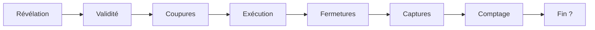

# QIDIGO — synthèse du tour 2 du C-K (03/11/2026)

Tout reste PISTE ou PROPOSITION : rien n'est une règle tant que DOCS/RULES.md n'existe pas (AGENTS.md). Les décisions de Lomig iront dans DOCS/DECISIONS.md (CDP).
Les réponses de Lomig à Q1–Q10 (03/11/2026, entre 7 h 18 et 7 h 26) sont relayées par CDP, dans la formulation de CDP : ce ne sont pas des citations.

## Chiffres

- 203 K (166 + 37 nouvelles, K167–K203) : 11 décisions et constats de Lomig relayés par CDP, 1 sur le site public (giscus), 16 externes à URL vérifiée, 9 déductions.
- 103 C (60 + 43 nouvelles, C17–C59). Décisions : 15 choisies, 23 écartées (conservées), les autres ouvertes.
- 317 opérateurs : 9 K→K, 102 C→C, 103 K→C, 103 C→K.
- Aucun identifiant existant n'a changé : les fils giscus des C, K et Q du tour 1 restent valables. Seul le texte du C0 a évolué.
- Commentaires giscus trouvés : aucun. Le dépôt blomig/QIDIGO-ck n'a encore aucune discussion (03/11/2026, vers 7 h 30, heure de Paris).

## Nouveau C0

> Duel classé 1 contre 1 pour iPhone (portrait), freemium sans pub, sur les 81 croisements d'une grille de traits 9×9 : chaque joueur a 5 pions ; à chaque tour (20 tours de 20 s), les deux joueurs donnent un ordre résolu en même temps — poser un pion, ou déplacer un pion par un trajet glissé au doigt le long des traits ; deux trajets qui passent par un même croisement ou un même segment se coupent, et une pose sur un trajet le coupe ; un trajet coupé est annulé, ainsi que l'ordre adverse (BRIEF) ; on gagne du terrain en fermant des zones avec ses trajets ; un pion adverse enfermé dans une zone est capturé, retourne dans la réserve de son propriétaire et peut être rejoué dès le tour suivant ; la partie finit après 20 tours, ou dès qu'un joueur contrôle 75 % des croisements (61 sur 81) ; ce qu'est une zone reste à explorer ; simple, rapide, profond.

## Réponses intégrées

| Q | Réponse | C choisies | C écartées (conservées) |
|---|---|---|---|
| Q1 | a) terrain par fermeture de zones | C2 | C1, C3, C4o, C5 |
| Q2 | a) même croisement ou segment, quel que soit le moment | C6, C6a | C6b, C6d |
| Q3 | a) une pose sur un trajet le coupe | C6c | — |
| Q4 | a) capture par enfermement | C2c, C8c | C2d, C8, C8a, C8b, C8d ; C8e et C8f implicitement |
| Q5 | a) rejouable dès le tour suivant | C10 (+ C10d implicite) | C10a |
| Q6 | a) N tours ou X %, au premier | C11b | C11, C11a |
| Q7 | a) croisements contrôlés, 75 % = 61 | C11c | C11d |
| Q8 | 20 tours de 20 s | C14, C59 | C14a |
| Q9 | 5 pions ; zones ouvertes | C12 | C12a, C12b |
| Q10 | b) glisser le long des traits | C16a | C16 |

Le passage de 15 s à 20 s est une K (K175) : Lomig avait trouvé 15 s trop rapide au JdS (selon CDP), où le chrono est passé à 30 s (R-5.2b du JdS).

Durée maximale = 20 × (20 s + résolution) (K200) :

| Résolution | 0 s | 2 s | 3 s | 5 s |
|---|---|---|---|---|
| Durée maximale | 6 min 40 s | 7 min 20 s | 7 min 40 s | 8 min 20 s |

Avec 5 s de résolution (valeur du JdS), on approche les 8 min 45 s du JdS. D'où les pistes : résolution de 2 à 3 s et bouton « Prêt ».

## Axe ZONES (C17–C42, sous C2 et C11c)

K externes vérifiées :
- **Qix** : seul le trait en cours est vulnérable ; le bord et les zones prises protègent (K179) ; séparer deux Qix finit le niveau (K180).
- **Volfied** : le côté qui contient l'ennemi principal est « l'extérieur » (K181).
- **Paper.io 2** : une traînée qui revient au territoire capture ce qu'elle entoure, et elle est vulnérable tant qu'elle n'est pas fermée (K182). Le bord est l'endroit le plus sûr (K183, à creuser).
- **Dots** : la chaîne compte aussi en diagonale, on n'entoure pas une zone vide, la zone entourée sort du jeu (K184) ; les programmes entourent la zone minimale (K185) ; règle d'ancrage au bord (K186).
- **Géométrie** : flood fill en 4 ou 8 directions (K187), théorème de Jordan (K188), règle pair-impair (K189).

Résultats :
1. **Ce qu'est une zone.** Les trajets suivent les traits, donc une boucle est un polygone à angles droits. Le calcul le plus simple remplit les 64 cases en 4-connexité : deux cases voisines communiquent si le segment entre elles n'est pas un mur (C17 ★, K199). La 8-connexité ne sert que si des pions isolés font frontière, comme dans Dots (C18).
2. **Le bord.** Le recommandé est C20 ★ : le bord est un mur, et une coupure bord à bord donne la plus petite part. Deux variantes : C21, on prend la part sans pion adverse (Qix, Volfied) ; C22, le bord ne compte pas. Une coupure droite laisse au plus 45 croisements à la plus petite part (K197) : pour atteindre 61, il faut plusieurs zones.
3. **Fermer une zone.**
   - Recommandé : traces persistantes, plusieurs trajets successifs (C23 ★) ; un trajet qui revient à son territoire ou à ses traces (C24 ★, Paper.io).
   - Variantes : un pion compte comme mur (C25) ; une chaîne de pions seule (C26). C26 s'écarte peut-être de Q1 a.
   - Avec 5 pions, une zone faite de pions seuls reste petite : 5 pions en diagonale dans un coin enferment 10 croisements, soit 15 contrôlés et 18,5 % (K198).
4. **Ce qui reste sur la grille.** Les traces restent (C23), ou bien elles s'effacent après 3 tours si elles ne bordent pas de zone (C27).
5. **Zones mixtes et emboîtées.**
   - Zone fermée par les murs des deux joueurs : à personne (C28 ★), ou à celui qui la ferme (C29).
   - Ma zone est interdite au jeu adverse (C30 ★, comme Dots) ou reprenable (C31, comme Paper.io).
   - Une zone qui contient des pions des deux joueurs capture les pions adverses et laisse les miens (C32, implicite dans Q4 a).
   - Une zone dans une zone n'existe que si les zones sont reprenables (C33).
6. **Taille minimale.** Une case 1×1 suffit et vaut 4 croisements de frontière (C34 ★). La variante C35 exige au moins un croisement intérieur, soit 2×2 cases et 9 croisements (K196).
7. **Perdre une zone.** La zone gagnée est définitive (C36 ★), ou bien elle se perd avec un de ses murs (C37).
8. **Fermetures au même tour.** Les deux comptent, et une zone emboîtée revient à son auteur (C38 ★). Variante : des fermetures qui se recouvrent sont annulées (C39).
9. **Comptage (Q7 a).** Contrôlés = pions + croisements des zones, frontière comprise (C40 ★) ; un croisement de frontière commune ne revient à personne (C42 ★). Variante : intérieur seulement (C41), mais alors une case 1×1 vaut 0.
10. **Capture avec 5 pions et rejeu immédiat.** Si le pion capturé peut se reposer aussitôt dans la zone, la capture ne coûte qu'un ordre (K203). D'où C30 et C57 : pas de pose dans une zone adverse.

### Exemples sur un coin de grille (5 × 4 croisements)

Notation : `o` croisement vide, `A` pion de A, `b` pion de B, `═` et `║` traces de A, `─` trajet de B ; le bord haut et le bord gauche sont des murs (C20).

**1. Une zone au coin, avec une capture.** Le pion A part de (2,0) et va jusqu'à (0,2) en passant par (2,1), (2,2) et (1,2). La zone fait 2 × 2 cases. Le pion b en (1,1) est enfermé, donc capturé (Q4 a). A contrôle 9 croisements (C40).

```
     x=0   1   2   3   4
y=0    o   o   o   o   o
               ║
y=1    o   b   o   o   o        b en (1,1) : capturé
               ║
y=2    A═══o═══o   o   o        zone de A : x ≤ 2, y ≤ 2 → 9 croisements
y=3    o   o   o   o   o
```

**2. Une coupure.** Le trajet de A va de (3,0) à (3,3) et celui de B de (1,2) à (4,2). Ils partagent le croisement (3,2) : les deux sont coupés, et les deux ordres sont annulés (Q2 a, BRIEF).

```
     x=0   1   2   3   4
y=0    o   o   o   A   o
                   ║
y=1    o   o   o   o   o
                   ║
y=2    o   b───────X───o        X = croisement commun : coupure
                   ║
y=3    o   o   o   o   o
```

**3. Une pose qui coupe (Q3 a).** B pose un pion en (3,2), sur le trajet de A. Le trajet de A est coupé. La pose a-t-elle lieu ? C'est Q16 ; la recommandation est C43, la pose a lieu.

**4. Une zone faite de pions seuls** (C26, 8-connexité). Cinq pions A en diagonale enferment les 10 croisements où x + y ≤ 3 : 15 croisements contrôlés, soit 18,5 % (K198).

```
y=0  ·  ·  ·  ·  A
y=1  ·  ·  ·  A
y=2  ·  ·  A
y=3  ·  A
y=4  A
```

## Tensions : solutions proposées

- **T-BLOCAGE.** Recommandé : C43, la pose coupante a lieu et seul le trajet est annulé ; C44, un trajet resté sur ses traces ou dans sa zone ne peut pas être coupé (refuge, comme le territoire de Paper.io). Écartées comme moins conformes au BRIEF : C45 (seul l'ordre coupant est annulé) et C46 (rebond).
- **T-POSE.** Poser ne gagne aucun terrain, puisque Q1 a fait gagner le terrain par les trajets (K201). Poser sert à entrer, à couper ou à reprendre un pion, et coûte l'ordre du tour (Q5 a). La tension est largement levée.
- **T-BOUCLE.** La limite de 20 tours garantit la fin (K202). Contre les cycles stériles : C57, pas de pose dans une zone adverse ★ ; C58, ko local.
- **T-ECRAN.** 43,7 pt ≈ 7,2 mm (K195), sous les 9,2 mm de Parhi (K191) : seulement 7 croisements tiendraient sur la largeur à 9,2 mm. Mais un glissé aimanté choisit une direction et non un point. Recommandé : aimantation à l'axe dominant (C47 ★), hystérésis de 60 % à tester (C48 ★), loupe décalée façon Shift (C49 ★, K192), retour arrière qui efface et lever du doigt qui valide (C52 ★), conformément aux recommandations d'Apple (K193). Une vibration par croisement (C55) est une piste. La grille 7×7 (C53) et le mode paysage (C54) sont écartés par le BRIEF et AGENTS.md.
- **T-DUREE.** Voir le tableau des durées : résolution de 2 à 3 s et bouton « Prêt ».

## Ordre de résolution d'un tour — PROPOSITION (C56)

0. **Révélation** simultanée des deux ordres.
1. **Validité.** Un trajet suit les traits et ne passe pas par un croisement occupé par un pion. Une pose exige un croisement vide et une réserve non vide. Avec C30 / C57, on ne pose pas dans une zone adverse.
2. **Coupures** (Q2 a, Q3 a).
   - Deux trajets partagent un croisement ou un segment : les deux trajets sont annulés (BRIEF).
   - Une pose tombe sur le trajet adverse : le trajet est annulé, et la pose a lieu (C43, voir Q16).
   - Deux poses sur le même croisement : les deux sont annulées.
   - Un trajet sur ses traces ou dans sa zone ne peut pas être coupé (C44, voir Q17).
3. **Exécution simultanée** : les poses sont posées, les pions se déplacent et les traces sont tracées.
4. **Fermetures.** Pour chaque joueur, on remplit les 64 cases en 4-connexité avec ses murs (traces, bord, voire pions). Les deux joueurs sont traités en même temps (C38).
5. **Captures.** Les pions adverses strictement à l'intérieur d'une zone fermée à ce tour retournent dans la réserve, tous en même temps. Un pion sur la frontière n'est pas capturé.
6. **Comptage** des croisements contrôlés sur 81 (C40, C42).
7. **Fin.**
   - Un joueur atteint 61 : il gagne.
   - Les deux atteignent 61 : le plus haut gagne ; à égalité exacte, on continue.
   - Au 20e tour : le plus grand total gagne ; l'égalité se règle par Q18.



## Nouvelles questions (Q11–Q18, un fil giscus par question)

Voir questions-lomig.md. Les zones d'abord : traces persistantes (Q11), bord (Q12), frontière dans le comptage (Q13), jeu dans la zone adverse (Q14), fermeture par les pions (Q15). Viennent ensuite la pose coupante (Q16), le refuge (Q17) et l'égalité au 20e tour (Q18).

## Prochaine étape

Faire une maquette papier de 10 tours avec l'ordre C56 et les recommandations ★, dès que Q11–Q15 ont une réponse.
